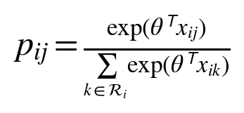
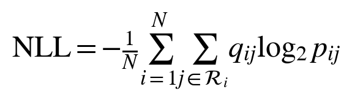
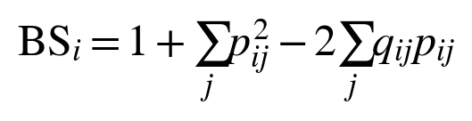
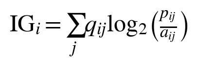
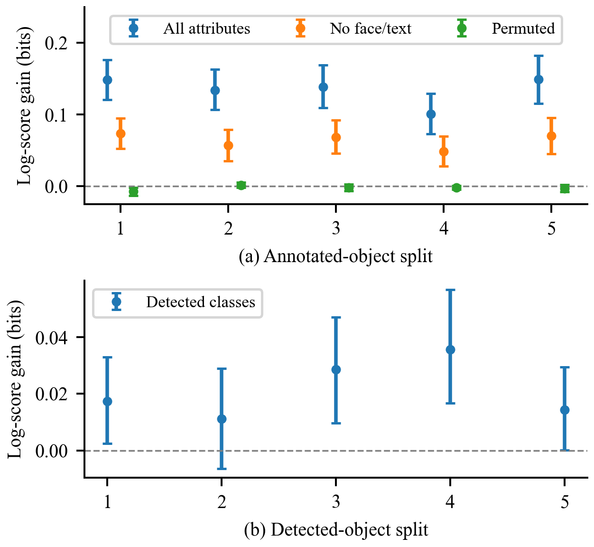

# Robustness of Object Attention Prediction With Annotated and Detected Objects

Göktuğ Sina Bekçioğulları

Department of Computer Engineering, Marmara University, İstanbul, Türkiye

### Abstract

Object-based gaze models often rely on human-defined regions and semantic labels that are absent at image-only inference. We compare annotated and detected representations using 700 OSIE scenes with an image-disjoint 420/140/140 split. Semantic annotations improve log score beyond geometry by 0.101 to 0.149 bits per fixation across five overlapping split sensitivities. On the original test set, human semantic and detected linear models achieve 1.515 and 0.501 bits of information gain over uniform pixels, versus 0.522 for a center prior. Frozen ResNet50 features with local or graph-attention heads do not improve these linear references. A frozen DeepGaze IIE comparator achieves 2.695 bits under documented common-pixel evaluation. Zero-shot evaluation on 698 public EMOd images gives the OSIE-trained detected linear model 0.206 bits versus 0.590 for the center prior. Excluding five OSIE observers from training and validation preserves a 0.149-bit semantic benefit for annotated regions. The evidence supports a reproducible analysis of representation limits and transfer, rather than a new attention mechanism. Pretraining differences, partial EMOd access and cohort-conditioned uncertainty limit broader conclusions.

Keywords: object attention, eye tracking, semantic attributes, object detection, robustness, probability evaluation

## 1 Introduction

Human gaze is spatially selective and often directed toward meaningful objects. Classical saliency models connect visual conspicuity with sequential selection [1], while OSIE was introduced to study object and semantic contributions beyond pixels [2]. A practical complication is that human-defined object regions and semantic labels may be available in an experiment but absent when a model receives a new image.

We investigate the robustness of object-region probabilities under that change in available information. First, we test whether semantic annotation improves on geometry and whether the gain survives image-split changes, feature removal and observer reweighting. Second, we build an image-only reference using a frozen detector and evaluate its class information and sensitivity to changes in predicted regions. Follow-up experiments test frozen visual features and graph mixing, compare a strong static saliency predictor, transfer fixed models to public EMOd photographs and exclude observer groups from fitting. A shared pixel-probability score allows comparison across partitions without treating different categorical event spaces as equivalent.

Attention is operationalized as recorded overt fixation behavior. The analysis does not measure covert attention, conscious experience or neural correspondence. The contribution is an empirical robustness analysis, common-support evaluation and executable image-only baseline. Semantic guidance of gaze and object-based prediction are established ideas; neither is claimed as a new mechanism here.

## 2 Related work and research positioning

Object representations are established in gaze modeling. Xu et al. combined pixel, object and semantic information [2]. OAT predicts search scanpaths as sequences of object fixations [3]. Consequently, predicting an object ranking or using semantic attributes does not establish methodological novelty. The OAT source consulted here is an arXiv preprint; its experiments concern visual-search layouts rather than this OSIE protocol.

Task and history also have strong precedents. Yang et al. modeled goal-directed attention through inverse reinforcement learning and a dynamic representation of foveated information [4]. DeepGaze III estimates fixation distributions conditioned on image content and fixation history [5]. HAT incorporates task-conditioned attention and foveated memory across search and free viewing [6]. These works are appropriate comparators for a future sequential model. The present static model does not compete with these systems on sequential prediction.

Uncertainty must be defined by what is uncertain. Mengers et al. use uncertainty in evolving object segmentation to guide exploration in dynamic scenes [7]. Our pilot instead concerns the predictive distribution over fixed annotated regions. MC dropout [8] and deep ensembles [9] are neural uncertainty methods; our bootstrap of a linear choice model is neither method. Temperature scaling [10] changes predictive sharpness, but an improvement on validation data does not guarantee an improvement on new scenes.

Individual differences require a separate evaluation design. Observer-conditioned scanpath models [11] and few-shot adaptation to unseen viewers [12] already address personalization. Our original split holds out images; the follow-up additionally excludes observer groups from fitting and validation, without learning individual preferences. Recent 2026 work further narrows the novelty space: ScanVLA addresses language-referred object search [13]; ST-DiffEye studies stochastic gaze generation with distribution-aware evaluation [14]; and DeepGaze3.5-VL studies autoregressive scanpath tokens [15]. The last two are cited as preprints, not as independently verified benchmarks.

This review was a targeted search of primary papers, proceedings, author repositories and dataset documentation through 2 November 2026. It is not an exhaustive systematic review. The experiment focuses on input assumptions and robustness within this established modeling framework.

## 3 Data and operational definitions

### 3.1 Dataset and scope

The pilot uses OSIE masks, semantic attributes and eye-tracking annotations from the authors' public repository [2]. Both files are pinned to revision 4a467890fcb40a2fec04cdded552760942bac7a4 and verified by SHA-256. The loaded files contain 700 scenes, 5,551 annotated objects and 10,500 image-observer records. The images are 800 by 600 pixels. The annotation-conditioned arm requires no photographs; the image-only arm additionally retrieves all 700 photographs from the same pinned repository revision. Their Git blob hashes and SHA-256 checksums are recorded. Photographs are not redistributed.

The twelve attribute channels are text, face, emotion, sound, smell, taste, touch, motion, operability, watchability, touched and gazed. In the source definition, gazed describes an object looked at by a person or animal depicted in the scene [2]; it does not encode the measured observer outcome. These annotations are still privileged semantic information. Their predictive value does not demonstrate that an automatic recognizer can recover the same signal.

COCO-Search18 concerns goal-directed search [4], [16] and is reserved for future experiments. SALICON uses mouse-contingent data [17] and can support spatial pretraining, but its records should not be treated as equivalent eye-tracked scanpath timing. The three datasets are not pooled in this pilot.

### 3.2 Region assignment and preprocessing

MATLAB HDF5 masks are transposed from stored width-by-height order. We turn overlapping source masks into one exhaustive partition. Background receives index zero; a pixel covered by multiple masks is assigned to the mask with the smallest original area, with source order breaking ties. Empty resulting regions are removed. This leaves 5,549 active object regions. The same partition is used for fixation labels and spatial-prior integration, so probability mass is not counted twice.

Eligible fixations have finite coordinates within the one-based image domain and recorded duration of at least 100 ms. Coordinates are rounded half upward and converted to zero-based indices; off-image samples are rejected rather than clipped. The primary analysis keeps the first recorded fixation. It removes 10,659 short or invalid-duration records from 98,321 source fixations, yielding 87,662 eligible events; no additional coordinates are rejected. Background accounts for 16.41 percent of eligible events. Repeated visits count as repeated events; duration is a filter, not a weight.

Overlap is substantial: 28.26 percent of eligible events fall inside multiple original masks. The smallest-mask rule is explicit but not uniquely correct, particularly for nested faces and bodies. An exploratory sensitivity analysis assigns each covered pixel to the containing mask with the nearest original centroid in pixel distance. Unlike the original OSIE matching procedure [2], neither analysis expands boundaries by a tolerance radius. A second, specified sensitivity analysis removes each observer's first recorded fixation before applying the other filters.

### 3.3 Estimand and data separation

For image i and active region j, let n_ij be the eligible fixation count and q_ij its fraction of all eligible fixations in that image. The target is the region of a randomly selected event within a randomly selected image. Images receive equal weight. Within an image, observers contributing longer eligible sequences contribute more events; the exploratory extension also evaluates equal observer weighting.

Sorted image names are permuted using NumPy default_rng with seed 20261102. The first 60 percent are training images, the next 20 percent validation images, and the rest test images. The resulting 420/140/140 split contains 52,510/17,636/17,516 eligible events. All observers viewing an image stay in that image's split. Models fit training outcomes only; regularization, center bandwidth and temperature use validation outcomes only. There is no retraining on the combined training and validation set.

## 4 Models and evaluation

### 4.1 Reference distributions and conditional choice

Uniform regions assigns equal probability to every active object region and background. The area prior is a uniform pixel density integrated over the partition. The center prior integrates a Gaussian over those same regions, using normalized horizontal and vertical coordinates. Its bandwidth is selected from 0.10, 0.15, 0.20, 0.30 and 0.40 by validation log score. These simple spatial references are not trained neural saliency systems.

The geometric model uses six region features: log area fraction, horizontal and vertical centroid offsets from image center, their squares, and a background indicator. The semantic model adds twelve annotation values, with zeros for background. A single shared parameter vector scores every region in every image. There is no region-specific identity embedding or test-image parameter.

We minimize mean training-image cross entropy in natural-log units plus one half lambda times the squared parameter norm. Features are not standardized. L-BFGS-B uses the analytic gradient; the chosen regularization coefficient comes from 0.0001, 0.001 and 0.01. Both models select 0.0001. A finite-difference test checks the gradient implementation.

### 4.2 Calibration and uncertainty diagnostics

For the semantic model, we fit a scalar temperature on validation outcomes with bounds 0.25 to 4.0. Temperature one is an explicit candidate. A ten-member ensemble refits the semantic model on bootstrap samples of training images, reusing its selected regularization. Member probabilities are averaged. The ensemble's temperature scales the logarithm of that mean probability vector and is fitted independently on validation images.

To describe ensemble sensitivity we calculate entropy of the averaged distribution minus mean member entropy, in bits. This is a Jensen-Shannon-type disagreement statistic for the bootstrap models. It is not a calibrated measure of neural epistemic uncertainty. Empirical outcome entropy and equal-observer empirical distribution disagreement are stored separately. Sparse observer sequences bias the latter; the manuscript does not interpret it as an unbiased estimate of intrinsic individual differences.

### 4.3 Proper scores and statistical uncertainty

The primary score is the image-average negative log likelihood in bits. The central comparison is geometric NLL minus semantic NLL, so positive differences favor semantic information.

We also report the expected multiclass Brier score for a single fixation event. This is different from squared distance to the empirical mean distribution, which removes the event variability term.

Log and Brier scores assess full categorical probabilities using proper scoring rules [18]. Top-1 and top-3 coverage measure the observed fixation fraction contained in the highest-ranked regions, including background. They are event-coverage measures, not the percentage of scenes whose most-viewed object was correctly identified. A positive temperature preserves ranking, so unchanged coverage after calibration is expected.

We report a ten-bin, image-weighted top-label expected calibration error and reliability curves as descriptive diagnostics [10]. Calibration error is bin-dependent and is not the optimization target. Paired percentile intervals use 5,000 bootstrap resamples of test images, with the same sampled image indices for both models. These intervals condition on the fitted models, chosen split and observed viewer cohort; they do not cover all sources of training or observer-population uncertainty. Sensitivity results are not independent replications.

### 4.4 Exploratory robustness analysis

After the original pilot, we specified five split seeds from 20261102 through 20261106. The images overlap across splits; these are sensitivity analyses rather than independent replications. Each model selects L2 from 0, 0.000001, 0.00001, 0.0001, 0.001 and 0.01 using validation data. We compare all attributes, removal of face, removal of text, removal of both, and a control that permutes complete semantic vectors among foreground objects within each image. Geometry and background remain unchanged. One permutation per split is a diagnostic rather than a permutation-test p-value.

An equal-observer evaluation averages each nonempty observer's fixation distribution before scoring. Training still uses the original event-weighted target. This checks the estimand but does not hold observers out. A separate inference-time stress test sets each object's full semantic vector to zero with probability 0, 0.25, 0.5, 0.75 or 1, using 20 deterministic repetitions. Parameters remain fixed. Synthetic omission is not an estimate of natural annotation error.

### 4.5 Image-only object probabilities

The image-only baseline uses Torchvision's Faster R-CNN MobileNetV3 Large 320 FPN with frozen COCO_V1 weights [19], [20]. The detector supplies boxes, classes and confidence from pixels. We retain scores of at least 0.5 and at most 50 detections, fixed before gaze evaluation. Higher confidence resolves overlapping boxes, with source order breaking ties; background covers all remaining pixels. Pixel centers determine box membership. Images with no detections remain in the study.

Three conditional-choice models use geometry alone, geometry plus detector confidence, or those seven features plus 91 COCO category slots. Unused category slots are zero. COCO categories are not estimates of OSIE's twelve semantic attributes. Training uses fixation outcomes, but inference uses no human object annotations or gaze. The six-value L2 grid and five image splits match the exploratory analysis. The executable predictor returns a normalized pixel probability map for a new image.

Comparisons across partitions require a common event space. We distribute each region probability uniformly over its pixels. For image i, let a_ij be region area divided by image area. Information gain over a uniform pixel distribution is then:

This equals log2 of the number of image pixels minus pixel NLL. Positive values indicate improvement over uniform pixels. For fixed regions, optimizing region cross entropy also optimizes pixel likelihood because the area term is constant with respect to model parameters. We also compare an image-independent Gaussian center density evaluated at the same fixation pixels; its bandwidth is selected on validation images. The original human-mask fits are rescored on this pixel support. Their richer features and different geometry prevent interpreting the gap as a pure detector effect.

With the original image-only model held fixed, we scale box width and height by 0.8 or 1.2 around each box center, or remove detections at probabilities 0.25, 0.5, 0.75 and 1. Features and partitions are recomputed without gaze. Deletion uses one fixed random draw with nested subsets across rates. These interventions are controlled stress tests, not measurements of natural detection accuracy; the tested scale factors are not selected as a new model using test results.

### 4.6 Frozen visual and relational controls

A frozen ImageNet ResNet50 [21] encodes each full photograph resized to 224 by 224 pixels. Area-weighted pooling of its 7 by 7 feature map produces 2048 features for each region. Training-only, image-balanced normalization precedes a 64-unit head. We compare visual features, visual plus geometry, and full features with local, uniform-context or learned additive graph-attention mixing [22]. Both partitions use seeds 11, 22 and 33, fixed AdamW settings, and validation-selected stopping within 50 epochs. The local and uniform controls share nominal parameters, but their attention-score parameters are inactive. ResNet receptive fields already include context; this experiment tests additional mixing, not the existence of relational human attention.

### 4.7 Static saliency and external transfer

DeepGaze IIE [23] supplies a strong frozen static image-only comparator on the same 140 OSIE test scenes. The pinned official implementation uses its released ensemble weights and MIT1003 center prior without OSIE fitting. RGB input is resized to 1024 by 768; output density is bilinearly resized to 800 by 600 and renormalized. Its SALICON and MIT1003 saliency training and ImageNet encoders differ from our training budget. Training-data overlap has not been exhaustively excluded. Thus the comparison measures delivered predictors, not equal-data architectural effects. IG remains primary. Secondary NSS, AUC-Judd without jitter, CC and target-to-prediction KL use identical fixation pixels. CC and KL use Gaussian target smoothing with sigma 0.03 times the shorter image side. The local/GAT saliency comparison fixes seed 11 in advance.

EMOd [24] provides an external free-viewing test. Its public image archive contains 698 author-collected photographs; the other 321 IAPS photographs require separate access and are not evaluated. Source fixation fields have reversed axis names: fix_y is horizontal and fix_x vertical. The chosen conversion matches the supplied binary fixation maps on all 698 images. We retain the same 100 ms duration filter. Exact file, decoded-RGB and resized-image hashes and a 64-bit perceptual-hash distance threshold of four find no OSIE matches; edited or cropped overlap is not exhaustively ruled out. The OSIE detector, visual encoder, linear coefficients, six neural checkpoints and center bandwidth remain frozen. No EMOd gaze selects parameters. EMOd object labels are not mapped to OSIE's twelve semantic attributes. DeepGaze is evaluated on OSIE only.

### 4.8 Held out observers

Three disjoint groups of five of OSIE's fifteen observer indices serve in turn as test observers. Each model fits on the other ten observers in the original 420 training images; regularization uses only those ten in the 140 validation images. Evaluation uses the five excluded observers in the 140 test images. Within-image targets weight eligible observers equally. Geometry and full linear models are reselected separately for annotated and detected regions using the six-value L2 grid. We average the three fold contrasts per test image before image bootstrapping. This tests prediction for unseen members of the observed cohort, not personalization or uncertainty over a new observer population.

## 5 Results

### 5.1 Semantic information improves the reference model

Table I reports held-out results. The selected Gaussian bandwidth is 0.2. The semantic model improves mean log score by 0.149 bits per fixation over geometry, with a paired 95 percent interval of [0.121, 0.177]. Its Brier score decreases from 0.837 to 0.805, and top-1 event coverage rises by 9.27 percentage points. These findings support a conditional association between annotated semantics and observed object-region selection in this split.

Table I  Held out object region probabilities on 140 OSIE scenes

| Model | NLL | Brier | Top 1 (%) | ECE |
|---|---|---|---|---|
| Uniform regions | 3.0105 | 0.8659 | 18.05 | 0.0517 |
| Area prior | 4.1922 | 1.1711 | 18.21 | 0.5156 |
| Center prior | 3.9116 | 1.0632 | 20.33 | 0.4012 |
| Geometry | 2.8265 | 0.8370 | 21.93 | 0.0367 |
| Semantics | 2.6777 | 0.8055 | 31.19 | 0.0207 |
| Semantics + T | 2.6777 | 0.8055 | 31.19 | 0.0207 |
| Ensemble | 2.6785 | 0.8057 | 31.11 | 0.0194 |
| Ensemble + T | 2.6785 | 0.8057 | 31.11 | 0.0194 |

NLL and Brier are lower-is-better. Top-1 is the percentage of eligible events covered by the predicted top region; ECE is expressed as a probability, not a percentage. T denotes temperature scaling. Every measure first averages within each image and then across images. NLL confidence intervals are recorded in the machine-readable results.

The area and integrated center priors perform poorly relative to uniform regions. This does not show that spatial bias is absent: background covers substantial image area and receives too much mass under these pixel-based references. The fitted geometry model learns a background adjustment and improves over uniform regions. Semantic information adds value beyond that adjustment, rather than merely defeating an uncorrected center prior.

### 5.2 Calibration does not add a clear benefit

The validation-fitted semantic temperature is 1.0011, close to one. Its test NLL improvement is -0.000027 bits, with a 95 percent interval of [-0.000059, 0.000005]. The bootstrap ensemble improves over the single semantic model by -0.000783 bits, with an interval of [-0.002006, 0.000367]. Neither interval excludes zero in the favorable direction. The result does not support adding these uncertainty components as performance improvements in this pilot.

The mean ensemble disagreement is 0.00237 bits per test image. Small disagreement is expected when bootstrap fits of a low-dimensional regularized model are similar; it does not demonstrate low human uncertainty or model correctness. Empirical outcome entropy and model disagreement are recorded separately. The ensemble's slightly smaller top-label ECE should not override its lack of a clear log-score gain.

### 5.3 Sensitivity to fixation onset and mask overlap

Removing the first recorded fixation retains 78,833 events and yields a semantic log-score improvement of 0.145 bits, with a paired 95 percent interval of [0.115, 0.174]. The exploratory nearest-centroid partition yields an improvement of 0.125 bits, with an interval of [0.100, 0.150]. Both contrasts favor semantic features. The magnitude depends on how nested and overlapping regions are defined, so the primary estimate should not be interpreted independently of its assignment policy.

Both checks retain the same image split and repeat model selection within the same validation images. Because the alternate partition changes the event definition, the meaningful comparison is the semantic-versus-geometry gain within each run. Absolute NLL values across partitions are not directly comparable. These checks do not address all boundary ambiguity; tolerance-based assignments and detector-generated masks remain untested.

### 5.4 Repeated splits and semantic controls

With the expanded regularization grid, semantic gains range from 0.101 to 0.149 bits across the five splits. Equal-observer scoring yields 0.104 to 0.153 bits. Removing face reduces the gain to 0.057 to 0.082 bits; removing both face and text leaves 0.049 to 0.073 bits. The attributes therefore contribute unequally, and the semantic effect is not exhausted by those two channels. Within-image permutation yields gains from -0.007 to 0.002 bits, offering no consistent benefit.

On the original split, inference-time semantic omission increases NLL from 2.677 bits with no omission to 2.806 at probability 0.5 and 2.892 with complete omission. These are averages over 20 omission draws. Zeroing the semantic inputs of a fitted model is different from training a new geometry-only model.

### 5.5 Image-only prediction and representation gap

The detector produces no retained boxes for 7 of 700 images. Predicted foreground covers 46.50 percent of image area and 76.90 percent of eligible fixations on average across images. Fixation coverage is not object-detection recall. Table II uses the same 140 test scenes and the same fixation pixels for all methods.

Table II  Shared pixel information gain on the original split

| Model | IG bits | 95% interval |
|---|---|---|
| Uniform pixels | 0.000 | [0.000, 0.000] |
| Center prior | 0.522 | [0.442, 0.603] |
| Detected geometry | 0.471 | [0.382, 0.566] |
| Geometry + confidence | 0.484 | [0.395, 0.578] |
| Detected classes | 0.501 | [0.412, 0.596] |
| Human geometry | 1.366 | [1.267, 1.458] |
| Human semantics | 1.515 | [1.412, 1.608] |

All entries are bits per fixation, averaged equally over images; larger is better. Intervals resample images and condition on fitted models and the observer cohort. Human annotations are privileged inputs. The detector's COCO pretraining is documented, but overlap with OSIE source photographs has not been exhaustively ruled out.

Detected classes improve over geometry and confidence by 0.017 bits on the original split, with paired interval [0.003, 0.033]. Across splits the gain ranges from 0.011 to 0.036 bits. The image-only model's original-split difference from the center prior is -0.021 bits, with interval [-0.137, 0.095]; it does not consistently outperform that reference across splits. Human semantics exceed the image-only model by 1.013 bits on the shared pixel support, with paired interval [0.904, 1.122]. This is a joint representation gap, not evidence that one isolated component causes the difference.

### 5.6 Sensitivity to predicted region changes

Shrinking box width and height by 20 percent changes original-split IG from 0.501 to 0.605 bits, while expansion changes it to 0.376. Shrinking reduces foreground fixation coverage from 77.49 to 68.80 percent. Thus higher coverage alone does not imply better probability density. The result is consistent with the uniform-within-box assumption spreading mass too broadly, but it does not isolate that explanation from changes in geometry and overlap.

Deleting detections with probabilities 0.25, 0.5 and 0.75 reduces IG to 0.361, 0.212 and 0.098 bits. Deleting all detections yields the uniform image density and zero IG by construction. These values describe one fixed deletion draw, so they do not estimate variability across all possible failure patterns.

### 5.7 Visual features and relation mixing

Thirty neural fits completed on the original split. Across three seeds, full local and GAT heads achieve 1.383 and 1.380 bits of IG with annotated regions and 0.367 and 0.328 bits with detected regions. GAT minus local improvement is -0.003 bits with paired image interval [-0.011, 0.005] for annotated regions and -0.039 [-0.062, -0.020] for detections. Uniform mixing performs similarly to GAT. Every neural variant underperforms the corresponding prior full-feature linear reference. These results do not support adding this mixing layer under the tested frozen features and training settings.

### 5.8 Strong static comparator and domain transfer

Table III reports the common-pixel comparison. DeepGaze IIE improves over the detected linear model by 2.194 bits, with paired interval [2.083, 2.305]. Its NSS is 3.771, AUC-Judd 0.932, CC 0.809 and KL 0.697 bits. This establishes a substantial gap to a pretrained spatial predictor under the documented preprocessing, without isolating architecture from training-data differences.

Table III  Static prediction on the same 140 OSIE test scenes

| Model | IG bits | NSS |
|---|---|---|
| Center prior | 0.522 | 0.842 |
| Detected linear | 0.501 | 0.884 |
| Detected local seed 11 | 0.380 | 0.749 |
| Detected GAT seed 11 | 0.318 | 0.733 |
| Human semantic linear | 1.515 | 2.302 |
| DeepGaze IIE | 2.695 | 3.771 |

On the 698 public EMOd scenes, 102,760 eligible events remain. Center and OSIE-trained detected linear IG are 0.590 and 0.206 bits. Their paired linear-minus-center difference is -0.384 [-0.421, -0.346]. The fixed linear model therefore underperforms the center prior on this target subset. Mean seed-specific IG for local and GAT heads is 0.088 and 0.064 bits. These are averages of scores, not prediction ensembles. There are 243 scenes without retained detections (34.8 percent); their region models return uniform density. All scenes remain in evaluation. This is zero-shot transfer to the available subset, not evaluation of all 1019 EMOd images.

### 5.9 Prediction for excluded observers

Full-minus-geometry log-score improvement for held-out observers is 0.149 bits with image interval [0.121, 0.177] for annotated regions, and 0.017 [0.002, 0.033] for detected classes beyond geometry and confidence. Full-model IG is 1.525 and 0.506 bits, respectively. The semantic association persists under this cohort holdout. The experiment does not learn individual preferences or establish adaptation to a new person.

## 6 Discussion and limitations

The completed comparisons preserve the distinction between privileged human annotations and image-only prediction. DeepGaze IIE demonstrates that the current region-uniform models leave considerable spatial information unused. It has a different pretraining regime, so its advantage is not a controlled estimate of one architectural component. Frozen coarse visual features and graph mixing did not improve the linear references. The finding is specific to these representations, settings and finite seeds.

The external test expands the evidence to the 698 available EMOd images, while excluding the unavailable IAPS subset. Missing observer records prevent assuming stable cross-image identities in EMOd. OSIE observer holdout supports transfer within the observed cohort but does not provide population-level intervals. The original test split was already examined before these exploratory follow-ups. Splits overlap, bootstrap intervals condition on fitted models and observed viewers, multiple contrasts are descriptive, and pretrained-data overlap remains incompletely audited. No claim of state-of-the-art performance, personalization or a validated neural mechanism follows.

## 7 Next comparisons

The next controlled comparison should replace uniform within-region probability with a learned spatial density while keeping the detector and split fixed. Box shrinkage must be selected on validation data if it becomes a model parameter. A matched class-permutation control for the detected representation and multiple deletion seeds would strengthen attribution of the class and failure-sensitivity effects.

DeepGaze IIE and the public EMOd transfer test now provide the stronger static comparator and second-dataset evidence. A learned within-region density, matched pixel decoder and carefully budgeted encoder fine-tuning remain future experiments. Sequence prediction additionally requires fixation history, return-fixation behavior and a stopping model. Foveation should be tested as a controlled change in visual information, using matched encoders and training budgets [4], [6], [7]. COCO-Search18 task transfer and support/query personalization remain distinct from the completed free-viewing and observer-cohort tests.

## 8 Reproducibility and research integrity

The repository includes source checksums, split manifests, analytic model code, validation selections, fitted coefficients, per-image metrics, tests, figure generation and this manuscript's source. All experiments use CPU computation. Detector weights are frozen; no detector retraining or cloud deployment was performed. Thirty-one contract tests cover region assignment, coordinate conversion, image separation, objective gradients, expected event Brier score, feature interventions, observer weighting, pixel normalization and probability-score equivalence. A packed implementation of the choice objective is checked against the original image-by-image objective, including unequal weights and variable numbers of regions.

Raw annotations and photographs are excluded from version control and retrieved from the original source. The repository attributes upstream data and avoids publishing individual fixation sequences. The pilot is an exploratory secondary analysis with a local protocol, not an externally preregistered study. Results concern gaze behavior and should not be used to infer private thoughts or diagnose individuals.

## 9 Conclusion

Semantic annotations improve region probabilities beyond geometry across the tested OSIE splits and held-out observer groups. Detected classes contribute less, and frozen visual features with graph mixing do not improve the linear reference. DeepGaze IIE substantially outperforms the region-uniform predictors on the same pixels. On 698 public EMOd images, the fixed detected linear model underperforms the center prior; the unavailable IAPS subset is explicitly excluded. The results identify representation and spatial-density limits; they do not establish a completed brain-inspired attention system.

## Acknowledgment

OpenAI Codex assisted with analysis-code implementation, experiment execution, figure generation, and drafting and revision of Sections I–IX. Reported statistics were computed from OSIE and the public EMOd subset by the released scripts. The author is responsible for verifying the code, citations and manuscript before submission.

## References

[1] L. Itti, C. Koch, and E. Niebur, “A model of saliency-based visual attention for rapid scene analysis,” IEEE Trans. Pattern Anal. Mach. Intell., vol. 20, no. 11, pp. 1254–1259, 1998, doi: 10.1109/34.730558.

[2] J. Xu, M. Jiang, S. Wang, M. S. Kankanhalli, and Q. Zhao, “Predicting human gaze beyond pixels,” Journal of Vision, vol. 14, no. 1, Art. no. 28, 2014, doi: 10.1167/14.1.28.

[3] Y. Fang, J. Yu, H. Zhang, R. van der Lans, and B. Shi, “OAT: Object-level attention transformer for gaze scanpath prediction,” arXiv:2407.13335, 2024. [Online]. Available: https://arxiv.org/abs/2407.13335

[4] Z. Yang et al., “Predicting goal-directed human attention using inverse reinforcement learning,” in Proc. IEEE/CVF Conf. Comput. Vis. Pattern Recognit. (CVPR), 2020, pp. 193–202.

[5] M. Kümmerer, M. Bethge, and T. S. A. Wallis, “DeepGaze III: Modeling free-viewing human scanpaths with deep learning,” Journal of Vision, vol. 22, no. 5, Art. no. 7, 2022, doi: 10.1167/jov.22.5.7.

[6] Z. Yang et al., “Unifying top-down and bottom-up scanpath prediction using transformers,” in Proc. IEEE/CVF Conf. Comput. Vis. Pattern Recognit. (CVPR), 2024, pp. 1683–1693, doi: 10.1109/CVPR52733.2024.00166.

[7] V. Mengers, N. Roth, O. Brock, K. Obermayer, and M. Rolfs, “A robotics-inspired scanpath model reveals the importance of uncertainty and semantic object cues for gaze guidance in dynamic scenes,” Journal of Vision, vol. 25, no. 2, Art. no. 6, 2025, doi: 10.1167/jov.25.2.6.

[8] Y. Gal and Z. Ghahramani, “Dropout as a Bayesian approximation: Representing model uncertainty in deep learning,” in Proc. Int. Conf. Mach. Learn. (ICML), PMLR, vol. 48, 2016, pp. 1050–1059.

[9] B. Lakshminarayanan, A. Pritzel, and C. Blundell, “Simple and scalable predictive uncertainty estimation using deep ensembles,” in Advances in Neural Information Processing Systems, vol. 30, 2017.

[10] C. Guo, G. Pleiss, Y. Sun, and K. Q. Weinberger, “On calibration of modern neural networks,” in Proc. Int. Conf. Mach. Learn. (ICML), PMLR, vol. 70, 2017, pp. 1321–1330.

[11] X. Chen, M. Jiang, and Q. Zhao, “Beyond average: Individualized visual scanpath prediction,” in Proc. IEEE/CVF Conf. Comput. Vis. Pattern Recognit. (CVPR), 2024, pp. 25420–25431, doi: 10.1109/CVPR52733.2024.02402.

[12] R. Xue et al., “Few-shot personalized scanpath prediction,” in Proc. IEEE/CVF Conf. Comput. Vis. Pattern Recognit. (CVPR), 2025, pp. 13497–13507.

[13] R. Quan, Y. Lai, D. Liang, and J. Qin, “Object referring-guided scanpath prediction with perception-enhanced vision-language models,” arXiv:2604.20361, 2026. [Online]. Available: https://arxiv.org/abs/2604.20361

[14] B. N. Zhao, O. Kara, J. Kim, and J. M. Rehg, “ST-DiffEye: Diffusion-based continuous gaze generation via joint scanpath-trajectory modeling,” arXiv:2606.15486, preprint, 2026. [Online]. Available: https://arxiv.org/abs/2606.15486

[15] S. Agrawal, M. Bethge, and M. Kümmerer, “DeepGaze3.5-VL: Modeling scanpaths via autoregressive token prediction,” arXiv:2607.02083, preprint, 2026. [Online]. Available: https://arxiv.org/abs/2607.02083

[16] Y. Chen, Z. Yang, S. Ahn, D. Samaras, M. Hoai, and G. Zelinsky, “COCO-Search18 fixation dataset for predicting goal-directed attention control,” Scientific Reports, vol. 11, Art. no. 8776, 2021, doi: 10.1038/s41598-021-87715-9.

[17] M. Jiang, S. Huang, J. Duan, and Q. Zhao, “SALICON: Saliency in context,” in Proc. IEEE Conf. Comput. Vis. Pattern Recognit. (CVPR), 2015, pp. 1072–1080.

[18] T. Gneiting and A. E. Raftery, “Strictly proper scoring rules, prediction, and estimation,” J. Amer. Stat. Assoc., vol. 102, no. 477, pp. 359–378, 2007, doi: 10.1198/016214506000001437.

[19] S. Ren, K. He, R. Girshick, and J. Sun, “Faster R-CNN: Towards real-time object detection with region proposal networks,” arXiv:1506.01497, 2015. [Online]. Available: https://arxiv.org/abs/1506.01497

[20] A. Howard et al., “Searching for MobileNetV3,” in Proc. IEEE/CVF Int. Conf. Comput. Vis. (ICCV), 2019. [Online]. Available: https://arxiv.org/abs/1905.02244

[21] K. He, X. Zhang, S. Ren, and J. Sun, Deep residual learning for image recognition, in Proc. CVPR, 2016. https://arxiv.org/abs/1512.03385

[22] P. Velickovic et al., Graph attention networks, in Proc. ICLR, 2018. https://arxiv.org/abs/1710.10903

[23] A. Linardos, M. Kummerer, O. Press, and M. Bethge, DeepGaze IIE: Calibrated prediction in and out-of-domain for state-of-the-art saliency modeling, in Proc. ICCV, 2021. https://arxiv.org/abs/2105.12441

[24] S. Fan, Z. Shen, M. Jiang, B. L. Koenig, J. Xu, M. S. Kankanhalli, and Q. Zhao, Emotional attention: A study of image sentiment and visual attention, in Proc. CVPR, 2018. https://openaccess.thecvf.com/content_cvpr_2018/papers/Fan_Emotional_Attention_A_CVPR_2018_paper.pdf
