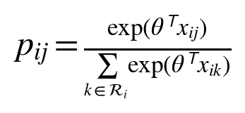
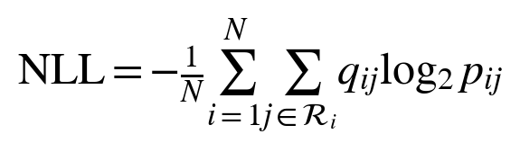
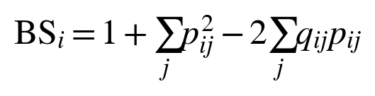

# Robustness of Object Attention Prediction With Annotated and Detected Objects

## A reproducible OSIE pilot and a protocol for brain inspired visual attention

Göktuğ Sina Bekçioğulları

Department of Computer Engineering, Marmara University, İstanbul, Türkiye

5 November 2026 | Exploratory research manuscript | Not peer reviewed

### Abstract

{{extension_abstract}}

Keywords: object attention, eye tracking, semantic attributes, object detection, robustness, probability evaluation

## 1 Introduction

Human gaze is spatially selective and often directed toward meaningful objects. Classical saliency models connect visual conspicuity with sequential selection [2], while OSIE was introduced to study object and semantic contributions beyond pixels [1]. A practical complication is that human-defined object regions and semantic labels may be available in an experiment but absent when a model receives a new image.

We investigate the robustness of object-region probabilities under that change in available information. First, we test whether semantic annotation improves on geometry and whether the gain survives image-split changes, feature removal and observer reweighting. Second, we build an image-only reference using a frozen detector and evaluate its class information and sensitivity to changes in predicted regions. Follow-up experiments test frozen visual features and graph mixing, compare a strong static saliency predictor, transfer fixed models to public EMOd photographs and exclude observer groups from fitting. A shared pixel-probability score allows comparison across partitions without treating different categorical event spaces as equivalent.

Attention is operationalized as recorded overt fixation behavior. The analysis does not measure covert attention, conscious experience or neural correspondence. The contribution is an empirical robustness analysis, common-support evaluation and executable image-only baseline. Semantic guidance of gaze and object-based prediction are established ideas; neither is claimed as a new mechanism here.

## 2 Related work and research positioning

Object representations are established in gaze modeling. Xu et al. combined pixel, object and semantic information [1]. OAT predicts search scanpaths as sequences of object fixations [7]. Consequently, predicting an object ranking or using semantic attributes does not establish methodological novelty. The OAT source consulted here is an arXiv preprint; its experiments concern visual-search layouts rather than this OSIE protocol.

Task and history also have strong precedents. Yang et al. modeled goal-directed attention through inverse reinforcement learning and a dynamic representation of foveated information [3]. DeepGaze III estimates fixation distributions conditioned on image content and fixation history [6]. HAT incorporates task-conditioned attention and foveated memory across search and free viewing [8]. These works are appropriate comparators for a future sequential model. The present static model does not compete with these systems on sequential prediction.

Uncertainty must be defined by what is uncertain. Mengers et al. use uncertainty in evolving object segmentation to guide exploration in dynamic scenes [9]. Our pilot instead concerns the predictive distribution over fixed annotated regions. MC dropout [17] and deep ensembles [18] are neural uncertainty methods; our bootstrap of a linear choice model is neither method. Temperature scaling [16] changes predictive sharpness, but an improvement on validation data does not guarantee an improvement on new scenes.

Individual differences require a separate evaluation design. Observer-conditioned scanpath models [10] and few-shot adaptation to unseen viewers [11] already address personalization. Our original split holds out images; the follow-up additionally excludes observer groups from fitting and validation, without learning individual preferences. Recent 2026 work further narrows the novelty space: ScanVLA addresses language-referred object search [12]; ST-DiffEye studies stochastic gaze generation with distribution-aware evaluation [13]; and DeepGaze3.5-VL studies autoregressive scanpath tokens [14]. The last two are cited as preprints, not as independently verified benchmarks.

This review was a targeted search of primary papers, proceedings, author repositories and dataset documentation through 2 November 2026. It is not an exhaustive systematic review. The experiment focuses on input assumptions and robustness within this established modeling framework.

## 3 Data and operational definitions

### 3.1 Dataset and scope

The pilot uses OSIE masks, semantic attributes and eye-tracking annotations from the authors' public repository [1]. Both files are pinned to revision 4a467890fcb40a2fec04cdded552760942bac7a4 and verified by SHA-256. The loaded files contain 700 scenes, 5,551 annotated objects and 10,500 image-observer records. The images are 800 by 600 pixels. The annotation-conditioned arm requires no photographs; the image-only arm additionally retrieves all 700 photographs from the same pinned repository revision. Their Git blob hashes and SHA-256 checksums are recorded. Photographs are not redistributed.

The twelve attribute channels are text, face, emotion, sound, smell, taste, touch, motion, operability, watchability, touched and gazed. In the source definition, gazed describes an object looked at by a person or animal depicted in the scene [1]; it does not encode the measured observer outcome. These annotations are still privileged semantic information. Their predictive value does not demonstrate that an automatic recognizer can recover the same signal.

COCO-Search18 concerns goal-directed search [3,4] and is reserved for future experiments. SALICON uses mouse-contingent data [5] and can support spatial pretraining, but its records should not be treated as equivalent eye-tracked scanpath timing. The three datasets are not pooled in this pilot.

### 3.2 Region assignment and preprocessing

MATLAB HDF5 masks are transposed from stored width-by-height order. We turn overlapping source masks into one exhaustive partition. Background receives index zero; a pixel covered by multiple masks is assigned to the mask with the smallest original area, with source order breaking ties. Empty resulting regions are removed. This leaves {{active_objects}} active object regions. The same partition is used for fixation labels and spatial-prior integration, so probability mass is not counted twice.

Eligible fixations have finite coordinates within the one-based image domain and recorded duration of at least 100 ms. Coordinates are rounded half upward and converted to zero-based indices; off-image samples are rejected rather than clipped. The primary analysis keeps the first recorded fixation. It removes {{duration_rejected}} short or invalid-duration records from {{raw_fixations}} source fixations, yielding {{retained}} eligible events; no additional coordinates are rejected. Background accounts for {{background_pct}} percent of eligible events. Repeated visits count as repeated events; duration is a filter, not a weight.

Overlap is substantial: {{overlap_pct}} percent of eligible events fall inside multiple original masks. The smallest-mask rule is explicit but not uniquely correct, particularly for nested faces and bodies. An exploratory sensitivity analysis assigns each covered pixel to the containing mask with the nearest original centroid in pixel distance. Unlike the original OSIE matching procedure [1], neither analysis expands boundaries by a tolerance radius. A second, specified sensitivity analysis removes each observer's first recorded fixation before applying the other filters.

### 3.3 Estimand and data separation

For image i and active region j, let n_ij be the eligible fixation count and q_ij its fraction of all eligible fixations in that image. The target is the region of a randomly selected event within a randomly selected image. Images receive equal weight. Within an image, observers contributing longer eligible sequences contribute more events; the exploratory extension also evaluates equal observer weighting.

Sorted image names are permuted using NumPy default_rng with seed 20261102. The first 60 percent are training images, the next 20 percent validation images, and the rest test images. The resulting 420/140/140 split contains {{train_fixations}}/{{val_fixations}}/{{test_fixations}} eligible events. All observers viewing an image stay in that image's split. Models fit training outcomes only; regularization, center bandwidth and temperature use validation outcomes only. There is no retraining on the combined training and validation set.

## 4 Models and evaluation

### 4.1 Reference distributions and conditional choice

Uniform regions assigns equal probability to every active object region and background. The area prior is a uniform pixel density integrated over the partition. The center prior integrates a Gaussian over those same regions, using normalized horizontal and vertical coordinates. Its bandwidth is selected from 0.10, 0.15, 0.20, 0.30 and 0.40 by validation log score. These simple spatial references are not trained neural saliency systems.

The geometric model uses six region features: log area fraction, horizontal and vertical centroid offsets from image center, their squares, and a background indicator. The semantic model adds twelve annotation values, with zeros for background. A single shared parameter vector scores every region in every image. There is no region-specific identity embedding or test-image parameter.

We minimize mean training-image cross entropy in natural-log units plus one half lambda times the squared parameter norm. Features are not standardized. L-BFGS-B uses the analytic gradient; the chosen regularization coefficient comes from 0.0001, 0.001 and 0.01. Both models select {{l2}}. A finite-difference test checks the gradient implementation.

### 4.2 Calibration and uncertainty diagnostics

For the semantic model, we fit a scalar temperature on validation outcomes with bounds 0.25 to 4.0. Temperature one is an explicit candidate. A ten-member ensemble refits the semantic model on bootstrap samples of training images, reusing its selected regularization. Member probabilities are averaged. The ensemble's temperature scales the logarithm of that mean probability vector and is fitted independently on validation images.

To describe ensemble sensitivity we calculate entropy of the averaged distribution minus mean member entropy, in bits. This is a Jensen-Shannon-type disagreement statistic for the bootstrap models. It is not a calibrated measure of neural epistemic uncertainty. Empirical outcome entropy and equal-observer empirical distribution disagreement are stored separately. Sparse observer sequences bias the latter; the manuscript does not interpret it as an unbiased estimate of intrinsic individual differences.

### 4.3 Proper scores and statistical uncertainty

The primary score is the image-average negative log likelihood in bits. The central comparison is geometric NLL minus semantic NLL, so positive differences favor semantic information.

We also report the expected multiclass Brier score for a single fixation event. This is different from squared distance to the empirical mean distribution, which removes the event variability term.

Log and Brier scores assess full categorical probabilities using proper scoring rules [15]. Top-1 and top-3 coverage measure the observed fixation fraction contained in the highest-ranked regions, including background. They are event-coverage measures, not the percentage of scenes whose most-viewed object was correctly identified. A positive temperature preserves ranking, so unchanged coverage after calibration is expected.

We report a ten-bin, image-weighted top-label expected calibration error and reliability curves as descriptive diagnostics [16]. Calibration error is bin-dependent and is not the optimization target. Paired percentile intervals use 5,000 bootstrap resamples of test images, with the same sampled image indices for both models. These intervals condition on the fitted models, chosen split and observed viewer cohort; they do not cover all sources of training or observer-population uncertainty. Sensitivity results are not independent replications.

{{extension_methods}}

{{continuation_methods}}

## 5 Results

### 5.1 Semantic information improves the reference model

Table 1 reports held-out results. The selected Gaussian bandwidth is {{bandwidth}}. The semantic model improves mean log score by {{gain}} bits per fixation over geometry, with a paired 95 percent interval of {{gain_ci}}. Its Brier score decreases from {{geometry_brier}} to {{semantics_brier}}, and top-1 event coverage rises by {{top1_gain}} percentage points. These findings support a conditional association between annotated semantics and observed object-region selection in this split.

Table 1  Held out object region probabilities on 140 OSIE scenes

{{results_table}}

NLL and Brier are lower-is-better. Top-1 is the percentage of eligible events covered by the predicted top region; ECE is expressed as a probability, not a percentage. Every measure first averages within each image and then across images. NLL confidence intervals are recorded in the machine-readable results.

The area and integrated center priors perform poorly relative to uniform regions. This does not show that spatial bias is absent: background covers substantial image area and receives too much mass under these pixel-based references. The fitted geometry model learns a background adjustment and improves over uniform regions. Semantic information adds value beyond that adjustment, rather than merely defeating an uncorrected center prior.

### 5.2 Calibration does not add a clear benefit

The validation-fitted semantic temperature is {{temperature}}, close to one. Its test NLL improvement is {{temperature_gain}} bits, with a 95 percent interval of {{temperature_ci}}. The bootstrap ensemble improves over the single semantic model by {{ensemble_gain}} bits, with an interval of {{ensemble_ci}}. Neither interval excludes zero in the favorable direction. The result does not support adding these uncertainty components as performance improvements in this pilot.

The mean ensemble disagreement is {{disagreement}} bits per test image. Small disagreement is expected when bootstrap fits of a low-dimensional regularized model are similar; it does not demonstrate low human uncertainty or model correctness. Empirical outcome entropy and model disagreement are recorded separately. The ensemble's slightly smaller top-label ECE should not override its lack of a clear log-score gain.

### 5.3 Sensitivity to fixation onset and mask overlap

{{sensitivity_text}}

Both checks retain the same image split and repeat model selection within the same validation images. Because the alternate partition changes the event definition, the meaningful comparison is the semantic-versus-geometry gain within each run. Absolute NLL values across partitions are not directly comparable. These checks do not address all boundary ambiguity; tolerance-based assignments and detector-generated masks remain untested.

{{extension_results}}

{{continuation_results}}

## 6 Discussion and limitations

{{extension_limitations}}

## 7 Next comparisons

The next controlled comparison should replace uniform within-region probability with a learned spatial density while keeping the detector and split fixed. Box shrinkage must be selected on validation data if it becomes a model parameter. A matched class-permutation control for the detected representation and multiple deletion seeds would strengthen attribution of the class and failure-sensitivity effects.

DeepGaze IIE and the public EMOd transfer test now provide the stronger static comparator and second-dataset evidence. A learned within-region density, matched pixel decoder and carefully budgeted encoder fine-tuning remain future experiments. Sequence prediction additionally requires fixation history, return-fixation behavior and a stopping model. Foveation should be tested as a controlled change in visual information, using matched encoders and training budgets [3,8,9]. COCO-Search18 task transfer and support/query personalization remain distinct from the completed free-viewing and observer-cohort tests.

## 8 Reproducibility and research integrity

The repository includes source checksums, split manifests, analytic model code, validation selections, fitted coefficients, per-image metrics, tests, figure generation and this manuscript's source. All experiments use CPU computation. Detector weights are frozen; no detector retraining or cloud deployment was performed. {{test_count}} contract tests cover region assignment, coordinate conversion, image separation, objective gradients, expected event Brier score, feature interventions, observer weighting, pixel normalization and probability-score equivalence. A packed implementation of the choice objective is checked against the original image-by-image objective, including unequal weights and variable numbers of regions.

Raw annotations and photographs are excluded from version control and retrieved from the original source. The repository attributes upstream data and avoids publishing individual fixation sequences. The pilot is an exploratory secondary analysis with a local protocol, not an externally preregistered study. Results concern gaze behavior and should not be used to infer private thoughts or diagnose individuals.

## 9 Conclusion

Semantic annotations improve region probabilities beyond geometry across the tested OSIE splits and held-out observer groups. Detected classes contribute less, and frozen visual features with graph mixing do not improve the linear reference. DeepGaze IIE substantially outperforms the region-uniform predictors on the same pixels. On 698 public EMOd images, the fixed detected linear model underperforms the center prior; the unavailable IAPS subset is explicitly excluded. The results identify representation and spatial-density limits; they do not establish a completed brain-inspired attention system.

## Acknowledgment

OpenAI Codex assisted with analysis-code implementation, experiment execution, figure generation, and drafting and revision of Sections I–IX. Reported statistics were computed from OSIE and the public EMOd subset by the released scripts. The author is responsible for verifying the code, citations and manuscript before submission.

## References

[1] Xu, J., Jiang, M., Wang, S., Kankanhalli, M. S., and Zhao, Q. (2014). Predicting human gaze beyond pixels. Journal of Vision, 14(1), 28. https://doi.org/10.1167/14.1.28

[2] Itti, L., Koch, C., and Niebur, E. (1998). A model of saliency-based visual attention for rapid scene analysis. IEEE Transactions on Pattern Analysis and Machine Intelligence, 20(11), 1254-1259. https://doi.org/10.1109/34.730558

[3] Yang, Z., Huang, L., Chen, Y., Wei, Z., Ahn, S., Zelinsky, G., Samaras, D., and Hoai, M. (2020). Predicting goal-directed human attention using inverse reinforcement learning. CVPR, 193-202. https://openaccess.thecvf.com/content_CVPR_2020/html/Yang_Predicting_Goal-Directed_Human_Attention_Using_Inverse_Reinforcement_Learning_CVPR_2020_paper.html

[4] Chen, Y., Yang, Z., Ahn, S., Samaras, D., Hoai, M., and Zelinsky, G. (2021). COCO-Search18 fixation dataset for predicting goal-directed attention control. Scientific Reports, 11, 8776. https://doi.org/10.1038/s41598-021-87715-9

[5] Jiang, M., Huang, S., Duan, J., and Zhao, Q. (2015). SALICON: Saliency in Context. CVPR, 1072-1080. https://openaccess.thecvf.com/content_cvpr_2015/html/Jiang_SALICON_Saliency_in_2015_CVPR_paper.html

[6] Kummerer, M., Bethge, M., and Wallis, T. S. A. (2022). DeepGaze III: Modeling free-viewing human scanpaths with deep learning. Journal of Vision, 22(5), 7. https://doi.org/10.1167/jov.22.5.7

[7] Fang, Y., Yu, J., Zhang, H., van der Lans, R., and Shi, B. (2024). OAT: Object-Level Attention Transformer for Gaze Scanpath Prediction. arXiv preprint. https://arxiv.org/abs/2407.13335

[8] Yang, Z., Mondal, S., Ahn, S., Xue, R., Zelinsky, G., Hoai, M., and Samaras, D. (2024). Unifying top-down and bottom-up scanpath prediction using transformers. CVPR, 1683-1693. https://doi.org/10.1109/CVPR52733.2024.00166

[9] Mengers, V., Roth, N., Brock, O., Obermayer, K., and Rolfs, M. (2025). A robotics-inspired scanpath model reveals the importance of uncertainty and semantic object cues for gaze guidance in dynamic scenes. Journal of Vision, 25(2), 6. https://doi.org/10.1167/jov.25.2.6

[10] Chen, X., Jiang, M., and Zhao, Q. (2024). Beyond Average: Individualized Visual Scanpath Prediction. CVPR, 25420-25431. https://doi.org/10.1109/CVPR52733.2024.02402

[11] Xue, R., Xu, J., Mondal, S., Le, H., Zelinsky, G., Hoai, M., and Samaras, D. (2025). Few-shot Personalized Scanpath Prediction. CVPR, 13497-13507. https://arxiv.org/abs/2504.05499

[12] Quan, R., Lai, Y., Liang, D., and Qin, J. (2026). Object Referring-Guided Scanpath Prediction with Perception-Enhanced Vision-Language Models. arXiv manuscript, record lists ICMR 2026. https://arxiv.org/abs/2604.20361

[13] Zhao, B. N., Kara, O., Kim, J., and Rehg, J. M. (2026). ST-DiffEye: Diffusion-based Continuous Gaze Generation via Joint Scanpath-Trajectory Modeling. arXiv preprint. https://arxiv.org/abs/2606.15486

[14] Agrawal, S., Bethge, M., and Kummerer, M. (2026). DeepGaze3.5-VL: Modeling Scanpaths via Autoregressive Token Prediction. arXiv preprint. https://arxiv.org/abs/2607.02083

[15] Gneiting, T., and Raftery, A. E. (2007). Strictly proper scoring rules, prediction, and estimation. Journal of the American Statistical Association, 102(477), 359-378. https://doi.org/10.1198/016214506000001437

[16] Guo, C., Pleiss, G., Sun, Y., and Weinberger, K. Q. (2017). On calibration of modern neural networks. ICML, PMLR 70, 1321-1330. https://proceedings.mlr.press/v70/guo17a.html

[17] Gal, Y., and Ghahramani, Z. (2016). Dropout as a Bayesian approximation: Representing model uncertainty in deep learning. ICML, PMLR 48, 1050-1059. https://proceedings.mlr.press/v48/gal16.html

[18] Lakshminarayanan, B., Pritzel, A., and Blundell, C. (2017). Simple and scalable predictive uncertainty estimation using deep ensembles. Advances in Neural Information Processing Systems, 30. https://proceedings.neurips.cc/paper/2017/hash/9ef2ed4b7fd2c810847ffa5fa85bce38-Abstract.html
