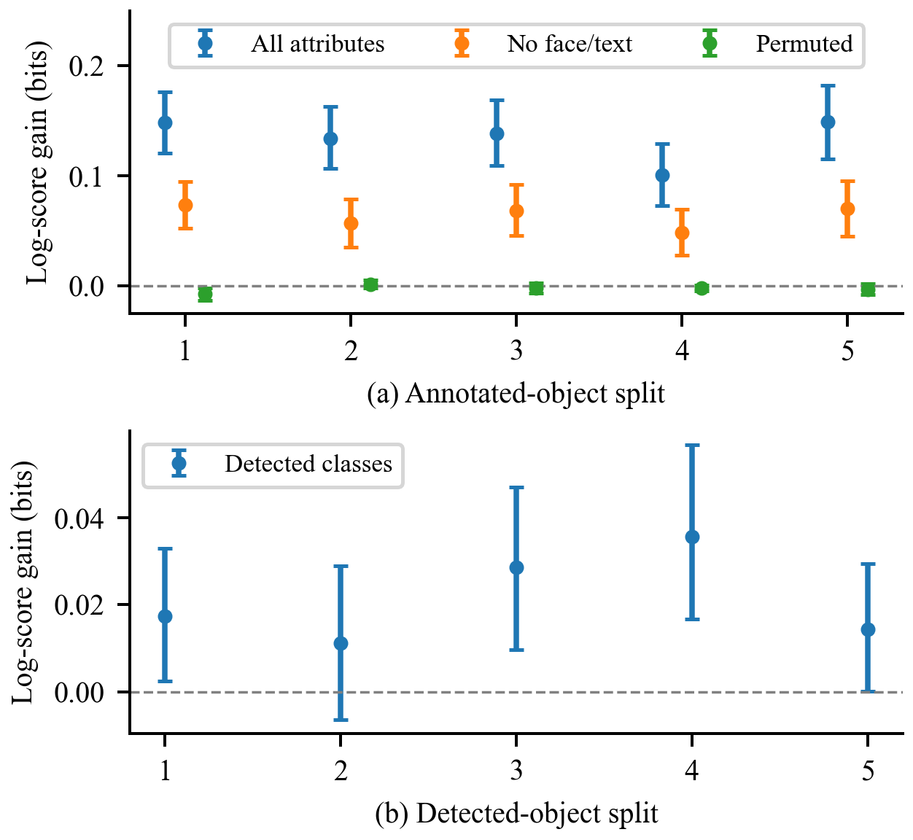

# Robustness and image-only results

Completed 2 November 2026. Exploratory extension; not a publication-readiness declaration.

## 5.4 Repeated splits and semantic controls

With the expanded regularization grid, semantic gains range from 0.101 to 0.149 bits across the five splits. Equal-observer scoring yields 0.104 to 0.153 bits. Removing face reduces the gain to 0.057 to 0.082 bits; removing both face and text leaves 0.049 to 0.073 bits. The attributes therefore contribute unequally, and the semantic effect is not exhausted by those two channels. Within-image permutation yields gains from -0.007 to 0.002 bits, offering no consistent benefit.

On the original split, inference-time semantic omission increases NLL from 2.677 bits with no omission to 2.806 at probability 0.5 and 2.892 with complete omission. These are averages over 20 omission draws. Zeroing the semantic inputs of a fitted model is different from training a new geometry-only model.

## 5.5 Image-only prediction and representation gap

The detector produces no retained boxes for 7 of 700 images. Predicted foreground covers 46.50 percent of image area and 76.90 percent of eligible fixations on average across images. Fixation coverage is not object-detection recall. Table 2 uses the same 140 test scenes and the same fixation pixels for all methods.

Table 2  Shared pixel information gain on the original split

| Model | IG bits | 95% interval |
|---|---|---|
| Uniform pixels | 0.000 | [0.000, 0.000] |
| Center prior | 0.522 | [0.442, 0.603] |
| Detected geometry | 0.471 | [0.382, 0.566] |
| Geometry + confidence | 0.484 | [0.395, 0.578] |
| Detected classes | 0.501 | [0.412, 0.596] |
| Human geometry | 1.366 | [1.267, 1.458] |
| Human semantics | 1.515 | [1.412, 1.608] |

All entries are bits per fixation, averaged equally over images; larger is better. Intervals resample images and condition on fitted models and the observer cohort. Human annotations are privileged inputs. The detector's COCO pretraining is documented, but overlap with OSIE source photographs has not been exhaustively ruled out.

Detected classes improve over geometry and confidence by 0.017 bits on the original split, with paired interval [0.003, 0.033]. Across splits the gain ranges from 0.011 to 0.036 bits. The image-only model's original-split difference from the center prior is -0.021 bits, with interval [-0.137, 0.095]; it does not consistently outperform that reference across splits. Human semantics exceed the image-only model by 1.013 bits on the shared pixel support, with paired interval [0.904, 1.122]. This is a joint representation gap, not evidence that one isolated component causes the difference.

## 5.6 Sensitivity to predicted region changes

Shrinking box width and height by 20 percent changes original-split IG from 0.501 to 0.605 bits, while expansion changes it to 0.376. Shrinking reduces foreground fixation coverage from 77.49 to 68.80 percent. Thus higher coverage alone does not imply better probability density. The result is consistent with the uniform-within-box assumption spreading mass too broadly, but it does not isolate that explanation from changes in geometry and overlap.

Deleting detections with probabilities 0.25, 0.5 and 0.75 reduces IG to 0.361, 0.212 and 0.098 bits. Deleting all detections yields the uniform image density and zero IG by construction. These values describe one fixed deletion draw, so they do not estimate variability across all possible failure patterns.

The image-only extension changes the main practical conclusion: semantic information is useful within each representation, but strong performance with human annotations does not establish a competitive image-only attention system. The current detected-region model sometimes falls below a simple center prior. Its class features differ from human semantic attributes, and its uniform spatial distribution within boxes is restrictive. The large human-versus-detected gap therefore motivates matched perception and spatial-density comparisons, rather than attributing the entire gap to detector quality.

The expanded analyses still use one small dataset and the same viewer cohort. Repeated splits overlap, intervention settings are exploratory, deletion uses one random draw, and controlled omission is not a realistic corruption model. Pretrained-detector data overlap has not been exhaustively audited. A second dataset, stronger image-only saliency comparator, repeated perturbations, and held-out observer evaluation remain necessary before broad performance or robustness claims.
