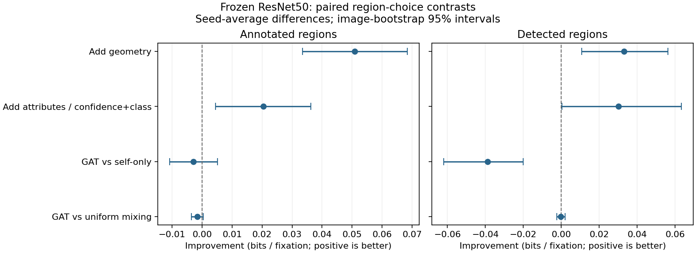

# Frozen visual features and object relations: measured results

Update, 5 November 2026: the historical next-stage list below is superseded by the [saliency and transfer report](saliency_transfer_results.md). Strong static saliency comparison, public EMOd transfer and observer exclusion are now complete and incorporated into the revised manuscript. ResNet+U-Net, fine-tuning and personalization remain future work.

Protocol dated 3 November 2026. See [protocol](relational_protocol.md) and [plan status](shared_plan_status.md).

The full experiment completed in 3.0 minutes on cpu. Both region partitions use the original 420/140/140 image split. Each model was trained with initialization seeds 11, 22, 33. Checkpoints were selected on validation NLL; test results did not select epochs or seeds.

The common validation-selected pixel center prior scores **0.5223 bits** above uniform pixels (bandwidth 0.2). Higher information gain (IG) and lower NLL/Brier are better.

## Annotated regions

| Model | NLL bits | IG bits | Brier | NDCG@3 | NLL seed SD |
|---|---:|---:|---:|---:|---:|
| visual | 2.8805 | 1.3117 | 0.8405 | 0.7118 | 0.0078 |
| visual_geometry | 2.8296 | 1.3626 | 0.8318 | 0.7812 | 0.0153 |
| full_self | 2.8092 | 1.3830 | 0.8287 | 0.7921 | 0.0100 |
| full_uniform | 2.8106 | 1.3816 | 0.8297 | 0.7913 | 0.0076 |
| full_gat | 2.8122 | 1.3800 | 0.8300 | 0.7890 | 0.0074 |

Paired improvements, averaged over initialization seeds before resampling test images:

| Contrast | Improvement bits | Image-bootstrap 95% interval | Per-seed improvements |
|---|---:|---|---|
| visual_geometry_over_visual | 0.0509 | [0.0335, 0.0685] | 0.0415, 0.0632, 0.0480 |
| full_self_over_visual_geometry | 0.0204 | [0.0044, 0.0363] | 0.0462, 0.0104, 0.0045 |
| full_gat_over_full_self | -0.0029 | [-0.0108, 0.0051] | -0.0088, 0.0003, -0.0004 |
| full_gat_over_full_uniform | -0.0016 | [-0.0035, 0.0004] | -0.0004, -0.0026, -0.0017 |

Previous full-feature linear reference NLL: 2.6777 bits. All reference comparisons align exactly the same 140 test image identities.

| Model | Gain over linear reference | 95% interval | Gain over center | 95% interval |
|---|---:|---|---:|---|
| visual | -0.2028 | [-0.2368, -0.1708] | 0.7895 | [0.6625, 0.9128] |
| visual_geometry | -0.1519 | [-0.1797, -0.1260] | 0.8403 | [0.7195, 0.9607] |
| full_self | -0.1315 | [-0.1588, -0.1053] | 0.8607 | [0.7397, 0.9825] |
| full_uniform | -0.1329 | [-0.1625, -0.1046] | 0.8594 | [0.7372, 0.9827] |
| full_gat | -0.1345 | [-0.1644, -0.1061] | 0.8578 | [0.7358, 0.9811] |

Observer disagreement groups use training-image Jensen–Shannon tertiles: 0.4803, 0.6525 bits.

| Group | Test images | Full self NLL | Full GAT NLL |
|---|---:|---:|---:|
| low | 39 | 2.3659 | 2.3665 |
| medium | 57 | 2.6868 | 2.6969 |
| high | 44 | 3.3608 | 3.3566 |

The paired image interval crosses zero; this run does not establish a GAT gain over the self-only control.

## Detected regions

| Model | NLL bits | IG bits | Brier | NDCG@3 | NLL seed SD |
|---|---:|---:|---:|---:|---:|
| visual | 1.6985 | 0.3036 | 0.6429 | 0.8789 | 0.0286 |
| visual_geometry | 1.6653 | 0.3368 | 0.6313 | 0.8908 | 0.0487 |
| full_self | 1.6351 | 0.3670 | 0.6197 | 0.8962 | 0.0152 |
| full_uniform | 1.6739 | 0.3282 | 0.6358 | 0.8890 | 0.0154 |
| full_gat | 1.6740 | 0.3280 | 0.6359 | 0.8893 | 0.0151 |

Paired improvements, averaged over initialization seeds before resampling test images:

| Contrast | Improvement bits | Image-bootstrap 95% interval | Per-seed improvements |
|---|---:|---|---|
| visual_geometry_over_visual | 0.0332 | [0.0108, 0.0562] | 0.0119, 0.0965, -0.0087 |
| full_self_over_visual_geometry | 0.0301 | [0.0003, 0.0634] | 0.0864, -0.0393, 0.0433 |
| full_gat_over_full_self | -0.0389 | [-0.0619, -0.0200] | -0.0617, -0.0300, -0.0251 |
| full_gat_over_full_uniform | -0.0001 | [-0.0024, 0.0020] | -0.0008, 0.0009, -0.0005 |

Previous full-feature linear reference NLL: 1.5010 bits. All reference comparisons align exactly the same 140 test image identities.

| Model | Gain over linear reference | 95% interval | Gain over center | 95% interval |
|---|---:|---|---:|---|
| visual | -0.1975 | [-0.2560, -0.1425] | -0.2187 | [-0.3635, -0.0716] |
| visual_geometry | -0.1642 | [-0.2281, -0.1076] | -0.1855 | [-0.3298, -0.0385] |
| full_self | -0.1341 | [-0.1804, -0.0903] | -0.1553 | [-0.2916, -0.0200] |
| full_uniform | -0.1729 | [-0.2336, -0.1171] | -0.1941 | [-0.3384, -0.0497] |
| full_gat | -0.1730 | [-0.2335, -0.1169] | -0.1942 | [-0.3383, -0.0495] |

Observer disagreement groups use training-image Jensen–Shannon tertiles: 0.1455, 0.2450 bits.

| Group | Test images | Full self NLL | Full GAT NLL |
|---|---:|---:|---:|
| low | 45 | 1.0950 | 1.1359 |
| medium | 42 | 1.5980 | 1.6223 |
| high | 53 | 2.1231 | 2.1719 |

The paired image interval favors the self-only control.

## Interpretation and limits

These are exploratory follow-up results on an already examined OSIE split, not a new independent replication. The intervals condition on the sampled observer cohort and fitted seeds; they omit full training uncertainty. Multiple descriptive contrasts are reported without a multiplicity correction. Seed SD is across training runs, not a confidence interval.

The annotated arm uses human masks and semantic attributes; the detected arm uses photographs and frozen detections. ResNet receptive fields already contain scene context. Adding GAT measures an extra mixing layer, not whether humans use relations. The self-only and uniform controls have equal nominal parameter counts, but their attention-score parameters are inactive. No claim of equal effective capacity or causal interpretation follows. In the detected arm, full features add confidence and class indicators jointly; the contrast does not isolate class information alone.

NDCG uses linear fixation-share relevance and averages tied predicted ranks. Background participates in ranking. Undefined Spearman correlations (constant targets or predictions, including one-region scenes) are excluded and counted in each run. Observer groups use test gaze only for descriptive evaluation; the model is not personalized. Pretraining overlap is not exhaustively excluded. Tiny objects share a coarse 7 x 7 feature grid.

ResNet+U-Net, a stronger externally pretrained saliency comparator, EMOd compatibility/overlap checking, cross-dataset evaluation, held-out-observer prediction and backbone fine-tuning have not been completed by this stage. These results do not establish superiority to conventional pixel saliency models. The existing six-page paper has not been revised to incorporate this follow-up.

## Reproduction and artifacts

- `results/relational/summary.json`: all seeds, validation histories, selected epochs, contrasts and source hashes.
- `results/relational/per_image_metrics.csv`: per-image proper scores, ranks and observer groups.
- `results/relational/visual_provenance.json`: encoder, detector, image and annotation provenance.
- `output/relational_checkpoints/relational/`: trained heads and training-only normalization (local, ignored by Git).
- `notebooks/object_attention_relations.ipynb`: Colab-compatible reproduction workflow.
- `output/visual_audit/`: ten local scene audits; manifest in `results/visual_audit/manifest.json`.
