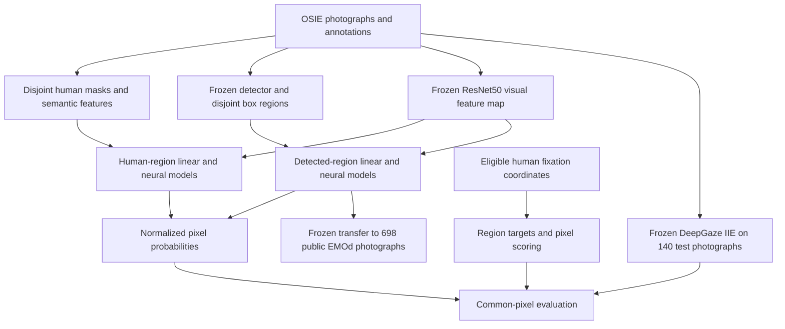

# Technical walkthrough of the object attention project

Status as of 5 November 2026. This report explains the completed implementation, the experimental logic, the measured results, and the remaining limits. Numerical tables are populated from saved experiment outputs by `scripts/build_technical_walkthrough.py`. Illustrative examples are explicitly marked as examples.

The central result is that human semantic annotations improve predictions of which region receives a fixation, but that benefit does not automatically produce a strong image-only system. The tested frozen detector and neural region models trail a strong pixel predictor, and their transfer to the available EMOd subset trails a simple center prior.

Read Sections 1–7 first for the problem and mathematics, Sections 8–20 for the experiments, and Sections 21–24 for verification, reproducibility and conclusions. The appendices give fitted coefficients, training selections and a code map.

Contents

- [1. What the project actually predicts](#1-what-the-project-actually-predicts)
- [2. How the research scope was chosen](#2-how-the-research-scope-was-chosen)
- [3. The complete data flow](#3-the-complete-data-flow)
- [4. Downloading and auditing OSIE](#4-downloading-and-auditing-osie)
- [5. Converting masks and fixation coordinates into valid targets](#5-converting-masks-and-fixation-coordinates-into-valid-targets)
- [6. Preventing the main forms of data leakage](#6-preventing-the-main-forms-of-data-leakage)
- [7. The first model and the mathematics of its evaluation](#7-the-first-model-and-the-mathematics-of-its-evaluation)
- [8. The initial result and why it supported a limited semantic claim](#8-the-initial-result-and-why-it-supported-a-limited-semantic-claim)
- [9. Calibration, bootstrap ensembles and uncertainty](#9-calibration-bootstrap-ensembles-and-uncertainty)
- [10. Checking whether the initial finding survives changes in the analysis](#10-checking-whether-the-initial-finding-survives-changes-in-the-analysis)
- [11. Building the automatic image-only system](#11-building-the-automatic-image-only-system)
- [12. Why we moved to a shared pixel score](#12-why-we-moved-to-a-shared-pixel-score)
- [13. Stress-testing the detector representation](#13-stress-testing-the-detector-representation)
- [14. Adding frozen visual features](#14-adding-frozen-visual-features)
- [15. The local, uniform-context and graph-attention heads](#15-the-local-uniform-context-and-graph-attention-heads)
- [16. Ranking and observer disagreement diagnostics](#16-ranking-and-observer-disagreement-diagnostics)
- [17. Comparing with DeepGaze IIE on exactly the same pixels](#17-comparing-with-deepgaze-iie-on-exactly-the-same-pixels)
- [18. Auditing EMOd before using it as an external test](#18-auditing-emod-before-using-it-as-an-external-test)
- [19. Zero-shot transfer and its result](#19-zero-shot-transfer-and-its-result)
- [20. Excluding observers from both training and validation](#20-excluding-observers-from-both-training-and-validation)
- [21. What was actually verified](#21-what-was-actually-verified)
- [22. Engineering decisions and reproducibility](#22-engineering-decisions-and-reproducibility)
- [23. What was written and delivered](#23-what-was-written-and-delivered)
- [24. How the evidence changes the project direction](#24-how-the-evidence-changes-the-project-direction)
- [Appendix A. Original semantic-model coefficients](#appendix-a-original-semantic-model-coefficients)
- [Appendix B. Selected neural epochs](#appendix-b-selected-neural-epochs)
- [Appendix C. Where each technical component lives](#appendix-c-where-each-technical-component-lives)
- [Appendix D. Terminology to keep separate](#appendix-d-terminology-to-keep-separate)

## 1. What the project actually predicts

The implemented task is **static free-viewing gaze prediction**. A person looks at a photograph without a specified search target. The model assigns probabilities to the locations or object regions where an eligible fixation could occur.

A fixation is a recorded gaze event with a position and duration. In this project, duration determines whether an event is included; it is not the quantity being predicted and is not a weight in the target distribution.

The current project does not load fMRI measurements. The historical directory name `fmri_visual-reconstruction` does not describe an implemented brain-to-image reconstruction experiment. No decoder reconstructs images from neural activity. The observations here are eye-tracking records, photographs and object annotations.

There are two related prediction spaces:

1. **Region prediction:** assign a probability to each object region and to background, when background exists.
2. **Pixel prediction:** assign a probability mass to every pixel, so the whole image sums to one.

The model predicts an aggregate distribution. It does not predict the next fixation conditional on previous fixations, generate a scanpath, predict when someone stops looking, or infer the person's thoughts. Fixation order is discarded when constructing the main count targets. Keeping or dropping the first fixation is a separate sensitivity choice.

The initial scientific questions were:

- Do human semantic attributes predict fixation allocation beyond size and position?
- Does that result survive reasonable preprocessing and feature controls?
- What happens when human regions and labels are replaced by automatic detections?
- Do frozen visual features and learned interactions improve that automatic model?
- How does it compare with a strong pretrained spatial predictor?
- Does it transfer to another dataset and to observers excluded from fitting?

These questions define the sequence of experiments. They do not assume that every added component will help.

## 2. How the research scope was chosen

The literature audit established that object-based gaze prediction, semantic guidance, foveation, personalized scanpaths and neural uncertainty already have substantial prior work. Combining those terms would not, by itself, establish novelty.

We therefore started with an inspectable conditional probability model and a narrow empirical question. That choice gave us a working reference before adding perception or neural-network complexity. The contribution supported by the completed work is a reproducible analysis of representation assumptions, controls and transfer, including negative results.

OSIE was useful because its photographs have human object masks, semantic attributes and gaze records. This makes it possible to ask whether semantics help when those annotations are available. COCO-Search18 concerns goal-directed search and was not substituted for free viewing. SALICON was not added as local training data; it enters the provenance of the external DeepGaze comparator. The previous [literature audit](literature_review.md) and [research brief](research_brief_2026-11-02.md) explain that positioning.

The protocols were written locally before their corresponding fits or scores. They are not external preregistrations. The nearest-centroid mask check was added after seeing overlap in the data audit, before inspecting its held-out scores. Later experiments reuse an already examined OSIE test split and must be described as exploratory follow-ups.

## 3. The complete data flow



The arrows from gaze lead to training targets and evaluation. Gaze is not an input to the automatic detector, visual feature extraction, or standalone image inference. Human masks and semantics are privileged inputs to the annotated arm, however, so that arm is not an image-only predictor.

This distinction is essential: an accurate model that receives human labels does not demonstrate that a model can discover those labels from a new photograph.

## 4. Downloading and auditing OSIE

The annotation source is the official OSIE repository, pinned to commit `4a467890fcb40a2fec04cdded552760942bac7a4`. `attrs.mat` and `fixations.mat` are verified by SHA-256. Photographs are retrieved from the same pinned source and checked using Git blob identities and recorded SHA-256 hashes.

Pinning fixes the exact source revision. A checksum detects an unexpected file change; it does not prove that the underlying annotations are scientifically correct. That is why we also perform schema, coordinate and visual checks.

The loader found:

| Item | Count |
|---|---:|
| Images | 700 |
| Image dimensions | 800 × 600 pixels |
| Human-annotated objects | 5,551 |
| Nonempty foreground regions after partitioning | 5,549 |
| Observer-image records | 10,500 |
| Source fixation events | 98,321 |
| Rejected for short or invalid duration | 10,659 |
| Further coordinate rejections in the primary OSIE run | 0 |
| Eligible events | 87,662 |
| Eligible background events | 14,388 |
| Eligible events covered by multiple original masks | 24,775 |

There are fifteen observer records per image. Ten thousand five hundred records means 700 × 15 observations of images by people; it does not mean 10,500 different people.

Files: [loader](../src/attention/data.py), [source audit](../results/primary/audit.json), [data card](../DATA_CARD.md).

## 5. Converting masks and fixation coordinates into valid targets

### 5.1 Correct the MATLAB storage convention

The masks in the HDF5 annotation file are stored with dimensions reversed relative to the image convention used by NumPy. Each mask is transposed from stored width-by-height to height-by-width. Without that conversion, a coordinate could select the wrong object even if the program ran without an exception.

Fixation coordinates use a one-based image domain. For a width W and height H, valid continuous coordinates satisfy `1 <= x <= W` and `1 <= y <= H`. Coordinates must be finite. We round halves upward and subtract one:

```text
pixel_x = floor(x + 0.5) - 1
pixel_y = floor(y + 0.5) - 1
```

Off-image samples are rejected before conversion. Clipping them onto an image border would invent observations at that border. The primary run retains the first recorded fixation and accepts duration at least 100 ms. A sensitivity run removes each observer's first recorded event before the duration and coordinate filters; it does not remove the first surviving event afterward.

### 5.2 Turn overlapping masks into one exhaustive partition

A pixel can belong to both a face mask and a larger person mask. Directly counting it in both would duplicate probability mass and fixation outcomes.

We construct one integer label map. Background has label zero. At an overlapping pixel, the smallest original mask wins; equal original areas are resolved by source index. The implementation paints larger masks first so smaller masks overwrite them. Regions with no pixels afterward are removed. Background is retained only if it has pixels.

The output is a disjoint partition: every pixel belongs to exactly one active region. The same partition defines fixation assignments, region areas and spatial-prior integration. Using different overlap policies for labels and priors would silently compare incompatible probabilities.

The smallest-mask rule is useful for nested small objects, but it is a modeling choice. It is not the only defensible assignment and is not identical to the source study's tolerance-expanded matching. We therefore also tested the nearest original-mask centroid among masks containing a pixel. Distances in that alternative are pixel distances, with stable source-order ties.

### 5.3 Build the target distribution

For image i and region j:

```text
n_ij = number of eligible fixation events assigned to region j
q_ij = n_ij / sum_k n_ik
```

`q_i` is a probability distribution over all active regions, including background when present. We retain a separate count vector for each observer as well as the pooled counts.

The primary estimand is: select an image uniformly, then select an eligible fixation event within that image. Consequently, every image has equal weight, but an observer with more events contributes more within that image. Repeated visits remain repeated events. Later equal-observer analyses deliberately change this weighting.

## 6. Preventing the main forms of data leakage

Sorted image names are permuted with NumPy `default_rng(20261102)` and divided into:

| Split | Images | Eligible events in the primary analysis | Purpose |
|---|---:|---:|---|
| Training | 420 | 52,510 | Fit parameters |
| Validation | 140 | 17,636 | Select regularization, center bandwidth, temperatures or epochs |
| Test | 140 | 17,516 | Measure the selected predictor |

All observers of an image stay in that image's split. Splitting individual fixations from the same photograph between training and test would let image-specific structure leak across the comparison.

The exact filenames are stored in [splits.json](../results/primary/splits.json). No final refit combines training and validation images. Neural normalization uses training images only. No EMOd gaze data tune the transferred models.

There are important boundaries to these protections. The initial image split does not hold people out. Later project decisions were informed by earlier test results, so this is not a sequence of untouched independent test sets. ImageNet, COCO and saliency pretraining introduce separate overlap questions that are not solved merely by keeping the OSIE split disjoint.

## 7. The first model and the mathematics of its evaluation

### 7.1 Six geometry features

For every disjoint region we compute:

| Feature | Definition | What it lets the model represent |
|---|---|---|
| Log area | `log(region_pixels / image_pixels)` | Preference associated with size |
| Centered x | Mean of `(pixel_x + 0.5)/W - 0.5` inside the region | Horizontal displacement |
| Centered y | Mean of `(pixel_y + 0.5)/H - 0.5` | Vertical displacement |
| Squared x | Square of the region's centered-x centroid | Symmetric horizontal position effect |
| Squared y | Square of the region's centered-y centroid | Symmetric vertical position effect |
| Background | One for background, zero otherwise | Separate background adjustment |

The squared features are squares of the region centroid, not averages of squared pixel coordinates. Geometry is computed after resolving overlaps, because the model's actual region is the surviving disjoint region.

The semantic model adds twelve supplied attributes: text, face, emotion, sound, smell, taste, touch, motion, operability, watchability, touched and gazed. Background gets zeros. This produces 18 features.

The `gazed` attribute refers to an object looked at by a person or animal depicted in the photograph. It is not the measured viewer's fixation outcome. Nevertheless, all twelve attributes are human-provided information, not outputs of our automatic recognizer.

### 7.2 Shared conditional softmax

Each region gets a score from one shared parameter vector:

```text
z_ij = theta^T x_ij
p_ij = exp(z_ij) / sum_k exp(z_ik)
```

The denominator runs over the regions in that image. There is no global object-identity embedding, no parameter specific to a test image, and no fixed number of objects required. An image with one active region necessarily receives probability one for it.

For two regions in the same image, `log(p_j/p_k) = theta^T(x_j-x_k)`. A coefficient describes an association conditional on the other supplied features. It is not evidence that changing a human observer's perception of that attribute would causally change gaze. Correlated features, regularization and their units affect coefficient interpretation.

### 7.3 Training objective and optimizer

The linear model minimizes mean image cross-entropy plus L2 regularization:

```text
L(theta) = mean_i [logsumexp(X_i theta) - q_i^T X_i theta]
           + (lambda/2) ||theta||^2

gradient = mean_i [X_i^T (p_i - q_i)] + lambda theta
```

The optimization loss uses natural logarithms; reported log scores use base two. We use L-BFGS-B from a zero coefficient vector with the analytic gradient, at most 1,000 iterations, `ftol=1e-11` and `gtol=1e-7`. Failed convergence raises an error. The original linear features are not standardized. This linear-softmax objective is convex, unlike the later neural objective; with positive L2 regularization it is strictly convex in the coefficients. Its small parameter count and comparatively straightforward optimization make it a useful initial reference, without guaranteeing that it will always generalize best.

The first grid is `{0.0001, 0.001, 0.01}`. Validation selects 0.0001 for both geometry and semantics. Later robustness and observer experiments use the explicitly expanded grid `{0, 0.000001, 0.00001, 0.0001, 0.001, 0.01}`. A later expanded-grid fit should not be silently substituted for the original fitted reference.

A packed implementation concatenates variable-length region arrays and applies segment-wise log-sum-exp. It is a speed improvement, not a different objective. Tests compare its value and gradient with the simpler image-by-image implementation, including unequal bootstrap weights.

### 7.4 What each score means

**Negative log likelihood in bits:** `NLL_i = -sum_j q_ij log2(p_ij)`. Lower is better. Assigning extremely low probability to events that occur incurs a large penalty. The score evaluates the full distribution.

**Expected multiclass Brier score:** `1 + sum_j p_ij^2 - 2 sum_j q_ij p_ij`. This is the expected squared error against the one-hot region of one fixation. Squared distance from the empirical distribution q would instead contain `sum(q^2)` in place of one. Those are different quantities.

**Top-1 and top-3 coverage:** the fraction of observed events in the predicted highest-ranked region or three regions. These are not percentages of images classified correctly. For example, if the chosen top region contains 30% of a scene's events, its top-1 coverage is 0.30 even when it is not that scene's most-viewed region. Background participates. The basic implementation resolves prediction ties by stable region order.

**Top-label ECE:** bin images by the probability assigned to the top region, compare average confidence with average observed event coverage in each bin, and average the absolute gaps with image weights. We use ten bins. ECE depends on binning and is a descriptive calibration diagnostic, not the training objective or a proper score.

**Entropy:** `H(p) = -sum p log2(p)` measures how spread out a distribution is. A high-entropy prediction is not automatically calibrated, and low entropy is not automatically correct.

Implementation: [model.py](../src/attention/model.py), [metrics.py](../src/attention/metrics.py).

### 7.5 Why comparisons are paired

For a proposed improvement A over reference B, we compute each image's difference, such as `NLL_B - NLL_A`, then average. Positive values favor A.

The 95% interval uses 5,000 bootstrap resamples of test-image indices, with replacement, and takes the 2.5th and 97.5th percentiles of the resulting means. Resampling the paired differences preserves the fact that both models faced the same scene difficulty. The bootstrap seed is 20261102.

These intervals condition on the fitted models, selected splits and sampled observers. They do not include every source of training uncertainty, uncertainty over the observer population, or bias from repeated scientific use of the test set. The many contrasts are descriptive; no multiplicity correction turns them into a single confirmatory family of tests.

## 8. The initial result and why it supported a limited semantic claim

| Model | Region NLL bits | Brier | Top-1 coverage | Top-3 coverage |
| --- | --- | --- | --- | --- |
| Uniform regions | 3.0105 | 0.8659 | 18.05% | 47.01% |
| Area prior | 4.1922 | 1.1711 | 18.21% | 50.87% |
| Integrated center prior | 3.9116 | 1.0632 | 20.33% | 54.17% |
| Geometry | 2.8265 | 0.8370 | 21.93% | 57.14% |
| Semantics | 2.6777 | 0.8055 | 31.19% | 64.20% |

The main comparison is semantic versus geometric features on exactly the same human regions. NLL improves by **0.148802 bits per fixation**, with paired interval **[0.120644, 0.176767]**. Brier also improves and top-1 coverage increases from 21.93% to 31.19%, a gain of 9.27 percentage points.

The logic is that regions, targets, splits and fitting family are held fixed while semantic inputs are added. The result supports predictive information beyond the six chosen geometry features. It does not prove a new psychological mechanism, recover semantics automatically, or isolate a causal intervention.

Bits are not percentage accuracy. A 0.148802-bit log-score improvement corresponds to approximately `2^0.148802 = 1.109` times the image-balanced geometric mean probability assigned to observed events. That is a probability-score interpretation, not a 14.9% or 10.9-percentage-point accuracy gain.

The simple area and center priors do poorly on region NLL. Large background areas receive substantial mass under these spatial priors, although fixation allocation is not proportional to area. Geometry learns an explicit background adjustment. Therefore the semantic comparison is against a fitted geometric reference, not merely against an intentionally weak area rule.

Source: [primary results](../results/primary/summary.json).

## 9. Calibration, bootstrap ensembles and uncertainty

We asked whether the fitted semantic model would improve through probability calibration or training-sample averaging.

Temperature scaling changes logits to `z/T`, with positive T. Values above one flatten predictions; values below one sharpen them. Validation selects T within [0.25, 4], and T=1 is explicitly retained as a candidate so numerical optimization cannot force a worse validation solution. Positive temperature preserves rankings, explaining why top-k coverage can remain unchanged.

The selected semantic temperature is approximately 1.00105. Its test improvement is **-0.000027 bits**, interval **[-0.000059, 0.000005]**. The sign is slightly unfavorable and the interval crosses zero. We do not report a calibration benefit.

The bootstrap ensemble contains ten linear models. Each fits a resample of the 420 training images, reuses the selected regularization and contributes probabilities to an arithmetic average. This is neither a neural deep ensemble nor Monte Carlo dropout. The ensemble's test improvement over the original semantic model is **-0.000783 bits**, interval **[-0.002006, 0.000367]**. Again, there is no clear favorable gain.

We distinguish three quantities:

- Predictive entropy: how diffuse a model's probabilities are.
- Bootstrap model disagreement: `H(mean model probability) - mean H(member probability)`.
- Empirical observer disagreement: the analogous quantity across each observer's normalized fixation counts.

The small mean bootstrap disagreement, about 0.00237 bits, means these fitted linear models are similar. It does not prove that the model is correct or that humans have little uncertainty. Individual observer distributions are estimated from short records, so empirical disagreement is also affected by sampling noise.

## 10. Checking whether the initial finding survives changes in the analysis

### 10.1 First fixation and overlap sensitivity

Removing each observer's first recorded fixation leaves 78,833 eligible events. The semantic advantage remains approximately **0.144501 bits**, interval **[0.115407, 0.174256]**. This checks sensitivity to the special status an initial fixation may have; it does not establish that every initial fixation is an artifact.

The nearest-centroid partition gives approximately **0.124997 bits**, interval **[0.100033, 0.149525]**. The benefit persists, but its size depends on the assignment policy. Because changing the partition changes the categorical event, we compare the semantic-minus-geometry effect within each partition, not absolute region NLL across partitions.

### 10.2 Five image splits and feature removal

We used seeds 20261102 through 20261106 and refitted six variants on each split: geometry, all semantics, no face, no text, no face or text, and permuted semantics. Each variant independently selects its regularization using validation data.

The all-attribute advantage ranges from **0.101 to 0.149 bits** across these splits. Removing face reduces the advantage to **0.057–0.082 bits**; removing both face and text leaves **0.049–0.073 bits**. The evidence suggests an appreciable contribution from those channels while leaving residual predictive information in other attributes. It does not identify independent causal contributions, because attributes correlate and models are refitted.

The permutation control shuffles complete twelve-attribute vectors among foreground objects within each image while preserving geometry and background. Its gains are approximately **-0.007 to 0.002 bits**. Thus the semantic alignment with the appropriate objects matters; merely adding the same number of input columns does not reproduce the benefit. One permutation per split is a diagnostic, not a complete permutation significance test.

The five test sets overlap. They measure sensitivity to the split, not five independent dataset replications.

### 10.3 Equal observers and missing semantics

For equal-observer scoring, each nonempty observer's counts are normalized first and then averaged. This prevents long fixation sequences from receiving extra within-image weight. The semantic gain remains **0.104–0.153 bits** across splits. These particular fits still used the event-weighted training targets; changing evaluation weights is different from excluding people from training.

We also zeroed each foreground object's entire semantic vector independently with probabilities 0, 0.25, 0.5, 0.75 or 1. Twenty deterministic repetitions were averaged while the trained model stayed fixed. NLL increases from about **2.677** with no omission to **2.806** at 50% omission and **2.892** with total omission.

This asks how a model trained to use semantics behaves when that information disappears at inference. It is not equivalent to training a geometry-only model, and it is not a measured distribution of real annotation failures.

Files: [robustness runner](../scripts/run_robustness.py), [interventions](../src/attention/robustness.py), [saved robustness results](../results/robustness/summary.json).

## 11. Building the automatic image-only system

The annotated arm cannot run on an unannotated photograph. We therefore added a frozen Torchvision `fasterrcnn_mobilenet_v3_large_320_fpn` detector using official `COCO_V1` weights. Its pretrained proposal, classification and box-processing machinery is retained; we do not train the detector on gaze.

The image enters the official detector transform. After its normal output processing, we retain predictions with score at least 0.5 and at most 50 detections. These settings are fixed, not selected using gaze test results.

Boxes become a disjoint pixel partition. Higher-confidence boxes overwrite lower-confidence boxes in overlaps; earlier source indices win exact confidence ties. Pixel centers determine membership. Uncovered pixels become background. This produces boxes and their surviving regions, not pixel-accurate semantic segmentation masks.

We fit three shared softmax models:

| Variant | Inputs | Coefficients |
|---|---|---:|
| Geometry | The same six geometric quantities | 6 |
| Geometry and confidence | Geometry plus detector confidence | 7 |
| Detected classes | Geometry, confidence and 91 category-index slots | 98 |

The 91 slots follow Torchvision's category indexing and include unused positions. This does not mean 91 substantive detected object classes. Foreground receives its category indicator; background receives zero confidence and zeros in the class block.

COCO classes are different information from OSIE's twelve human attributes. A detected category such as a person is not equivalent to an automatically recovered vector of face, text, emotion or social relations. The human-versus-detected comparison changes both the regions and their descriptions.

Training uses gaze targets, but inference requires only a photograph and the fitted model. The predictor returns region probabilities and a normalized pixel map. On OSIE, seven of 700 images have no retained detections. They are kept, with a valid background-only output.

Files: [detector extraction](../scripts/extract_detections.py), [region construction](../src/attention/image_only.py), [training](../scripts/run_image_only.py), [image inference](../scripts/predict_attention.py).

## 12. Why we moved to a shared pixel score

### 12.1 Region NLL is not comparable across different partitions

A detector may produce fewer, larger regions than the human masks. Predicting one of four broad categories is a different event space from predicting one of twelve narrow regions. The detector's lower numerical region NLL would not establish better localization.

We instead turn every region distribution into a full-image probability distribution. If region j has A_j pixels and probability p_j, every pixel in it gets `p_j/A_j`. The model is uniform within its own region. Since regions are exhaustive and disjoint, summing over the whole image gives one.

Let M be the number of image pixels and `a_j=A_j/M` the area fraction. Relative to a uniform pixel distribution `1/M`, the information gain is:

```text
IG_i = sum_j q_ij log2(p_ij / a_ij)
pixel_NLL_i = log2(M) - IG_i
```

For a fixed partition, `IG_i = -region_NLL_i - sum_j q_ij log2(a_ij)`. The area term does not depend on model coefficients. Thus minimizing region cross-entropy also maximizes this pixel likelihood within that fixed partition. Cross-partition comparisons become meaningful only after accounting for area and evaluating the same fixation pixels.

### 12.2 A worked example

Illustrative example, not an experimental image: take a 100-pixel image partitioned into background, person and sign with areas `[80, 10, 10]`. Suppose ten observed events have counts `[2, 6, 2]`, giving target `[0.2, 0.6, 0.2]`. A model predicts region probabilities `[0.2, 0.5, 0.3]`.

The pixel probabilities are 0.0025 in background, 0.05 in the person region and 0.03 in the sign region. Their ratios to uniform pixels are `[0.25, 5, 3]`. Therefore:

```text
IG = 0.2 log2(0.25) + 0.6 log2(5) + 0.2 log2(3)
   = about 1.310 bits per fixation
```

Assigning 0.5 probability to a 10-pixel region concentrates probability much more than assigning it to an 80-pixel region. This is the size effect that an unadjusted categorical comparison misses.

### 12.3 Two different center references

The early region analysis integrates a Gaussian over regions and evaluates region probabilities. When those masses are converted back using uniform-within-region density, their internal spatial shape is lost.

The later pixel reference evaluates the Gaussian directly at fixation pixels. It preserves variation within each region. Those two predictors should not be treated as identical merely because both are called center priors. The direct pixel Gaussian uses normalized x/y coordinates, a validation-selected bandwidth of 0.2 and no image content.

The later shared-pixel OSIE results are:

| Predictor | IG over uniform pixels, bits |
|---|---:|
| Uniform pixels | 0.000 |
| Direct center prior | 0.522 |
| Detected geometry | 0.471 |
| Detected geometry and confidence | 0.484 |
| Detected classes | 0.501 |
| Human geometry | 1.366 |
| Human semantics | 1.515 |

Detected classes add about **0.017 bits** beyond geometry and confidence, with interval **[0.003, 0.033]**. However, detected classes minus the direct center prior is **-0.021 bits**, interval **[-0.137, 0.095]**. The latter result does not establish a reliable advantage in either direction on that split.

The human-semantic predictor exceeds detected classes by about **1.013 bits**, interval **[0.904, 1.122]**. This is a combined representation gap. It does not tell us how much is due separately to box boundaries, missed objects, category differences or model specification. The human-semantic reference is a privileged-input baseline, not a proven upper bound on image-based prediction.

## 13. Stress-testing the detector representation

With the original detected-class coefficients fixed, we changed predicted boxes and recomputed partitions and features.

| Intervention | IG bits |
|---|---:|
| Original boxes | 0.501 |
| Width and height multiplied by 0.8 | 0.605 |
| Width and height multiplied by 1.2 | 0.376 |
| Delete each detection with probability 0.25 | 0.361 |
| Delete with probability 0.50 | 0.212 |
| Delete with probability 0.75 | 0.098 |
| Delete all detections | 0.000 |

Shrinking both dimensions by 20% would reduce an isolated unclipped rectangle's area to 64%, not 80%. Overlap and image boundaries make the actual partition change more complicated.

Shrinkage reduces foreground fixation coverage from 77.49% to 68.80% while improving IG. There is no contradiction: covering more events and assigning higher probability density are different goals. A broad box can include many fixation positions but spread its mass too thinly. However, resizing also changes geometry and overlap, so this does not isolate uniform density as the only cause.

We did not adopt 0.8 as a validated new hyperparameter after observing its test score. That would require validation-only selection and a subsequent appropriate evaluation. Deletion uses one fixed random draw with nested retained subsets across deletion rates; it does not measure variability over many detector failures. Foreground fixation coverage is not annotated-object detection recall.

## 14. Adding frozen visual features

The linear models do not learn a visual representation from pixels. To test whether visual features help, we used official ResNet50 `IMAGENET1K_V2` weights, removed global pooling and the classifier, and froze the remaining encoder in evaluation mode. Batch-normalization statistics stay fixed, and no gradient updates the backbone.

The full RGB photograph is resized to 224 × 224 with bilinear interpolation, without a center crop. This preserves the presence of image edges, although it distorts a non-square aspect ratio. We normalize channels by means `[0.485, 0.456, 0.406]` and standard deviations `[0.229, 0.224, 0.225]`.

The output is a 2048 × 7 × 7 feature map. Each disjoint region mask is area-resampled to 7 × 7, and the region feature is the coverage-weighted average of those 49 feature vectors:

```text
v_j = sum_u coverage_j(u) F(u) / sum_u coverage_j(u)
```

Area resampling lets even a tiny region contribute fractional coverage, rather than disappearing under a hard nearest-grid assignment. A one-pixel-region test checks this behavior. However, it does not create high-resolution visual information: tiny objects still share a coarse feature grid and large receptive fields.

We extract one full-image map and pool both human and detector regions from it. We do not separately crop every region, run an ROI encoder, train a U-Net, or fine-tune ResNet. The cached region rows are checked against image names and active region IDs before use.

The model inputs are:

| Feature variant | Annotated regions | Detected regions |
|---|---:|---:|
| Visual only | 2,048 | 2,048 |
| Visual and geometry | 2,054 | 2,054 |
| Full | 2,066 = 2,048 + 18 | 2,146 = 2,048 + 98 |

Before training neural heads, each feature column is standardized using training images only. Each image contributes its mean over regions equally to the global mean; the second moment is weighted the same way. The standard deviation is computed from those moments, and values below 1e-5 are replaced by one. This prevents images with more regions from dominating normalization and avoids dividing by near-zero variance.

Files: [visual.py](../src/attention/visual.py), [feature extraction](../scripts/extract_visual_features.py), [provenance](../results/relational/visual_provenance.json).

## 15. The local, uniform-context and graph-attention heads

### 15.1 Exact architecture

For standardized region vector x_j, all three heads first compute:

```text
h_j = ReLU(W_encoder x_j + b_encoder)       # 64 dimensions
z_j = W_value h_j                          # 64 dimensions, no value bias
```

They differ in the message m_j:

```text
Local:       m_j = z_j
Uniform:     m_j = mean_k z_k
Learned GAT: e_jk = LeakyReLU(a_source^T z_j + a_target^T z_k, slope=0.2)
             alpha_jk = softmax_k(e_jk)
             m_j = sum_k alpha_jk z_k
```

The learned graph is complete within each image, includes self-edges and background, and uses one attention head. There are no cross-image edges or explicit pairwise distance features. Position can affect attention through the input features, but it is not supplied as a separate relative-edge encoding.

All variants finish with a residual combination and scalar readout:

```text
score_j = w_output^T ReLU(h_j + m_j) + b_output
p_j = softmax_over_valid_regions(score_j)
```

Variable region counts are padded inside a batch. A Boolean mask excludes padding from attention and the final softmax. The cross-entropy is averaged over images, not over padded positions or a pooled set of regions. Reordering the region rows should reorder the output probabilities without changing their association with regions; this permutation equivariance is tested. The model cannot exchange messages between different images in the batch.

The local model's **logit** for a region depends only on that region's encoded input, but its final probability still competes with every other region through the softmax denominator. Also, its input already contains broad scene context through ResNet receptive fields. Calling it local does not mean its pixels were processed without context.

### 15.2 What the controls isolate

The local control asks whether region-specific features suffice. Uniform mixing asks whether simply sharing an image-level average helps. GAT asks whether learned weights over other regions add something beyond those alternatives.

All three full-feature variants have equal nominal parameter counts: 136,577 in the annotated arm and 141,697 in the detected arm. The source/target attention vectors, 128 parameters in total, are unused in local and uniform modes. Equal nominal count is therefore not identical effective capacity. The visual-only model has 135,425 parameters; visual-plus-geometry has 135,809.

The graph layer is a concrete additive-attention mechanism. It is not evidence that the brain uses that mechanism, and individual graph weights have not been validated as human explanations.

### 15.3 Training and model selection

| Setting | Value |
|---|---|
| Optimizer | AdamW |
| Learning rate | 0.0001 |
| Weight decay | 0.001 |
| Hidden width | 64 |
| Image batch size | 16 |
| Maximum epochs | 50 |
| Early-stopping patience | 10 epochs without a new validation minimum |
| Gradient-norm clipping | 5 |
| Initialization and shuffle seeds | 11, 22, 33 |
| Checkpoint selection | Lowest validation NLL |
| Backbone updates | None |

There are five configurations: visual, visual_geometry, full_self, full_uniform and full_gat. Two partitions × five configurations × three seeds produce **30 selected fits** and **4,200 test image-model-seed rows**. Initialization seeds are repeated trainings on the same data, not new datasets. Test outcomes do not select a seed or epoch.

The selected epochs are in Appendix B. The training loop records each epoch's training and validation NLL, saves the best parameter state, and restores it before test scoring. Predictions are floored at 1e-12 and renormalized to avoid zero-probability numerical failures in reported scores.

### 15.4 Results and what they justify

| Partition | Model | Mean region NLL | Mean pixel IG | NDCG@3 | NLL seed SD |
| --- | --- | --- | --- | --- | --- |
| annotated | visual | 2.8805 | 1.3117 | 0.7118 | 0.0078 |
| annotated | visual_geometry | 2.8296 | 1.3626 | 0.7812 | 0.0153 |
| annotated | full_self | 2.8092 | 1.3830 | 0.7921 | 0.0100 |
| annotated | full_uniform | 2.8106 | 1.3816 | 0.7913 | 0.0076 |
| annotated | full_gat | 2.8122 | 1.3800 | 0.7890 | 0.0074 |
| detected | visual | 1.6985 | 0.3036 | 0.8789 | 0.0286 |
| detected | visual_geometry | 1.6653 | 0.3368 | 0.8908 | 0.0487 |
| detected | full_self | 1.6351 | 0.3670 | 0.8962 | 0.0152 |
| detected | full_uniform | 1.6739 | 0.3282 | 0.8890 | 0.0154 |
| detected | full_gat | 1.6740 | 0.3280 | 0.8893 | 0.0151 |

Adding geometry to visual-only features improves the seed-averaged proper score by 0.0509 bits for annotated regions and 0.0332 for detected regions. Adding the full feature block gives another 0.0204 and 0.0301 bits, respectively. In the detected arm, that last addition includes both confidence and categories; it does not isolate categories alone.

GAT minus the full local control is **-0.0029 bits**, interval **[-0.0108, 0.0051]**, for annotations, and **-0.0389 bits**, interval **[-0.0619, -0.0200]**, for detections. GAT and uniform mixing perform almost identically. Every neural variant underperforms the corresponding earlier full-feature linear reference under the tested setup.

The supported interpretation is that this additional mixing layer has not earned its complexity here. Plausible explanations include limited training data, a coarse frozen representation, mismatched regularization or optimization, and a task where the selected features already support a good simple predictor. We did not isolate these explanations experimentally. The results do not prove that all neural models, all GATs or all forms of object interaction are inferior.

For intervals, scores are averaged over seeds per image before bootstrapping images. Averaging scores is not the same as averaging predicted probabilities into an ensemble; taking a logarithm makes those operations different.

The NLL seed SD column is the sample standard deviation of the three runs' mean test NLL values. It describes sensitivity to initialization and shuffling in these runs. It is not an image-bootstrap confidence interval or an estimate of observer-population uncertainty.

## 16. Ranking and observer disagreement diagnostics

We also compute Spearman correlation between predicted probabilities and empirical fixation shares; NDCG@3; and mean absolute probability error. Spearman uses average ranks for ties. When a target or prediction is constant, correlation is undefined, excluded from its mean and explicitly counted. It is not silently replaced by zero.

NDCG uses linear fixation-share relevance and discounts `1/log2(rank+1)`. Predicted probability ties receive their expected relevance under tied ordering. The ideal ordering uses descending target relevance. Background participates in all ranks. These metrics are secondary descriptions: a predictor can rank regions sensibly while assigning badly calibrated probabilities.

For observer disagreement, each nonempty observer's region counts are normalized. We compute entropy of their mean distribution minus their mean entropy, a Jensen–Shannon-type statistic. Low, medium and high cutoffs are the training-image tertiles, separately for each partition. Test gaze is used only to assign descriptive evaluation groups after prediction, not as an input to the network.

Annotated cutoffs are approximately 0.4803 and 0.6525 bits; detected cutoffs are 0.1455 and 0.2450. These numbers are not directly interchangeable because the partitions differ. Coarser regions can merge disagreements that exist at finer resolution.

Higher-disagreement groups have higher NLL in these outputs, but that is a descriptive association. This grouping neither trains a personalized model nor proves that disagreement causes errors.

## 17. Comparing with DeepGaze IIE on exactly the same pixels

The next question was whether the region predictors were competitive with a strong static spatial predictor. We used the official frozen DeepGaze IIE implementation pinned at commit `c7db17e2d1d7ea6468ffdee2cfaddf141095dcff`.

This is a static model: no previous human fixation is supplied. The inspected implementation combines four feature backbones—RGBShapeNetC, EfficientNet-B5, DenseNet201 and ResNeXt50—with 30 mixture components per backbone, corresponding to three instances and ten cross-validation folds. These are pretrained components from the official release, not 120 models that we trained on OSIE. The component saliency readouts use 1×1 convolutions, normalization and Softplus, followed by the released fixation-selection and density-finalization machinery.

The model's saliency training includes SALICON and MIT1003, and its feature backbones have their own pretraining. That gives it a different training budget and supervision history from our OSIE-trained heads. We treat it as a comparator between available predictors, not a matched-data architecture experiment or a claim that it is the latest state of the art.

Our exact adapter is:

1. Resize the full photograph from 800 × 600 to 1024 × 768 with Lanczos, without cropping.
2. Supply floating-point RGB values in [0,255], following the upstream model API. This differs from our normalized ResNet input.
3. Resize the supplied MIT1003 log center-bias map with nearest-neighbor interpolation and subtract log-sum-exp to normalize it.
4. Run the frozen official model in evaluation mode.
5. Exponentiate its log probability output.
6. Bilinearly resize probabilities back to 800 × 600 with `align_corners=False`, then normalize again.
7. Cache densities, input image hashes, library source hashes, center-bias identity and weight hashes.

We evaluated the same 140 test images and the same eligible fixation coordinates. No OSIE outcome selected these preprocessing settings or recalibrated DeepGaze. A namespace import adapter avoids the package's unrelated eager MSDB/CLIP import while loading the unchanged IIE implementation.

| Predictor | IG bits | NSS | AUC-Judd | CC | KL bits |
| --- | --- | --- | --- | --- | --- |
| Uniform | -0.0000 | 0.0000 | 0.5000 | 0.0000 | 2.8789 |
| Center | 0.5223 | 0.8419 | 0.7418 | 0.2530 | 2.3811 |
| Detected linear | 0.5011 | 0.8838 | 0.6831 | 0.2453 | 2.4330 |
| Detected local, seed 11 | 0.3800 | 0.7491 | 0.6792 | 0.2045 | 2.5689 |
| Detected GAT, seed 11 | 0.3184 | 0.7331 | 0.6789 | 0.1996 | 2.6355 |
| Human semantic linear | 1.5145 | 2.3023 | 0.8186 | 0.5221 | 1.8123 |
| DeepGaze IIE | 2.6953 | 3.7708 | 0.9321 | 0.8094 | 0.6969 |

DeepGaze exceeds the detected linear predictor by **2.194183 bits**, interval **[2.083075, 2.304917]**. Under this image-balanced log score, that difference corresponds to about 4.58 times the geometric mean probability assigned to observed fixation pixels. It is not 4.58 times an accuracy percentage.

It also exceeds the human-semantic region-uniform reference. That is possible because human labels do not make a particular probability model optimal: a spatial predictor can place mass at precise locations inside and outside those regions. The comparison establishes an output-performance gap; it does not apportion that gap between training data, visual encoders, region quality and spatial-density modeling.

### 17.1 Secondary pixel metric definitions

All maps are finite, nonnegative and normalized. For numerical log scoring, zero values are floored at 1e-300 before normalization. Likelihood and NSS retain repeated fixation events; the AUC target uses unique fixation pixels.

- **NSS:** z-score the predicted pixel map using its mean and population standard deviation over all pixels, then average the z-score at fixation events. The implementation returns zero when the standard deviation is at most 1e-15, covering constant maps.
- **AUC-Judd:** threshold at the unique predicted values at positive fixation pixels, calculate true- and false-positive fractions including ties, add ROC endpoints and integrate trapezoidally. No random jitter is used. Constant maps yield 0.5. This particular positive-threshold finite-grid construction can differ from a rank AUC using every possible threshold. A deliberately reversed four-pixel test gives 0.25 under this Judd convention rather than the zero of the full-threshold rank statistic.
- **CC:** Pearson correlation of the predicted pixel density with a smoothed empirical density. The implementation returns zero when the product-of-norms denominator is at most 1e-20, covering constant predictions.
- **KL:** `sum_pixel q * log2(q/p)`, from the smoothed empirical density q to prediction p, in bits. Lower is better; this is not a symmetric distance.

For CC and KL, fixation counts are smoothed with a Gaussian whose standard deviation is 3% of the shorter image dimension, with reflect boundaries, then normalized. This is 18 pixels for OSIE and 23.04 for EMOd. Bandwidth affects the target and therefore these scores. We did not optimize a different prediction map for each metric, and these numbers are not official benchmark submissions.

Files: [DeepGaze extraction](../scripts/extract_deepgaze.py), [common scoring](../scripts/compare_saliency.py), [metric implementation](../src/attention/saliency.py).

## 18. Auditing EMOd before using it as an external test

The public image archive contains **698 author-collected photographs**, all at 1024 × 768. The full annotation release covers 1,019 images, but the other **321 IAPS photographs** require separate access and were unavailable here. We did not fill that gap with substitute images or claim a 1,019-image evaluation.

The author annotation repository is pinned at `d0d1758ac4eef9e7db6ceef78d1bfdf3dfa14d02`. The downloader verifies exact hashes for the image archive, fixation records, attribute metadata, object annotations and official fixation-map archive. Public download access is not treated as permission to redistribute the photographs.

### 18.1 Detecting the axis reversal

The source field names are misleading: `fix_x` contains vertical coordinates and `fix_y` horizontal coordinates. We compared alternative axis assignments and rounding rules against the official binary fixation maps before transfer scoring. The selected swapped-axis, one-based half-up conversion hits the official map at every coordinate considered valid in that audit: **106,334 events over all 698 images**.

The coordinate-map audit and the final event count are different quantities. The former checks coordinate transformation against binary maps without the final duration filtering. The final loader applies finite duration >=100 ms and strict in-image continuous coordinates.

| EMOd audit quantity | Count |
|---|---:|
| Available images | 698 |
| Subject-image records | 11,148 |
| Source events in those records | 106,448 |
| Rejected by duration filter | 3,581 |
| Subsequently rejected by coordinate filter | 107 |
| Eligible events | 102,760 |

Some images have incomplete subject arrays. We therefore do not assume that array positions consistently identify the same EMOd observer across images. Equal-observer scoring within an image is still possible, but this release was not used to construct cross-image personalized profiles.

The loaded object file contains 3,627 object records across its 1,019 annotations, with polygon, category and sentiment-related fields; 3,557 records have a category field. We report the loaded schema rather than forcing it to match a headline object count. These annotations are not mapped to OSIE's twelve attributes and are not inputs to the transferred image-only models.

### 18.2 Screening overlap

Before looking at transfer scores, we compared every available EMOd photograph with all 700 OSIE photographs using:

1. Exact file SHA-256.
2. Exact decoded RGB content and shape hash.
3. Exact hash after RGB resizing to 32 × 32.
4. A 64-bit perceptual hash from low-frequency DCT coefficients, excluding any target with Hamming distance at most four to an OSIE image.

No candidates met those rules, so the nonoverlap primary set and all-available sensitivity set both contain 698 images. This does not exclude every possible crop, edit or shared source, and it does not audit every external pretraining corpus.

Files: [downloader](../scripts/download_emod.py), [schema and overlap audit](../scripts/audit_emod.py), [EMOd loader](../src/attention/emod.py), [audit output](../results/emod_audit/summary.json).

## 19. Zero-shot transfer and its result

Zero-shot here means no EMOd gaze data fit, calibrate, stop or select the evaluated models. We freeze the detector, its threshold and preprocessing, ResNet encoder, OSIE feature means/standard deviations, the original linear coefficients, six full-feature neural checkpoints and center bandwidth 0.2.

For each target image we build the automatic partition and visual features, predict probabilities, and only then use gaze for scoring. The nine evaluated predictors are uniform, center, linear, three local seeds and three GAT seeds. This produces **698 × 9 = 6,282 image-model rows**.

| Predictor on 698 EMOd images | IG bits |
| --- | --- |
| Uniform | 0.000000 |
| Center | 0.589749 |
| Detected linear | 0.206201 |
| Local, mean of three seed scores | 0.088224 |
| GAT, mean of three seed scores | 0.063511 |

The linear-minus-center difference is **-0.383548 bits**, with interval **[-0.421259, -0.346279]**. The center prior is decisively better under this conditional image-bootstrap comparison. The neural region models also fail to improve on the linear reference.

**243 of 698 images, or 34.8%, have no retained detections.** With only one background region, all region models return uniform pixel density and exactly zero IG in mathematical terms. Floating-point output can differ from zero by a negligible amount. Keeping these cases evaluates the delivered pipeline rather than a cherry-picked subset where perception succeeded.

The high empty-detection rate is an observed limitation of this detector/threshold on the available target images. It does not establish that the images contain no objects or that it alone explains the entire performance gap. We did not conduct a causal decomposition or tune the threshold after seeing the result.

It is also unsafe to subtract OSIE IG from EMOd IG and interpret the difference solely as degradation of a fixed task. The datasets have different images, gaze distributions and support dimensions. The most defensible comparison is against baselines evaluated within each dataset, on the same events. Uniform-referenced IG accounts for pixel count but does not make all dataset difficulty identical.

DeepGaze was evaluated on OSIE only. No EMOd DeepGaze score was computed or inferred.

## 20. Excluding observers from both training and validation

The earlier equal-observer analysis changed weights; it did not test unseen people. We therefore ran a separate refitting experiment using OSIE's fifteen source-order observer entries. Their positions are treated as consistent observer identities across images, following the release's ordering. This identity assumption is part of the loader contract; the count of fifteen alone would not prove identity consistency in an arbitrary dataset.

| Fold | Test observer indices | Training and validation observer indices |
|---|---|---|
| 0 | 0–4 | 5–14 |
| 1 | 5–9 | 0–4 and 10–14 |
| 2 | 10–14 | 0–9 |

For each fold, training uses only the other ten observers on the original 420 training images. Regularization selection uses only those same ten on the 140 validation images. Final evaluation uses the five excluded observers on the 140 test images. Thus evaluation excludes both the training images and the training/validation observer group.

Within an image we average each eligible observer's normalized distribution equally, for training, validation and testing. We refit geometry and full linear models separately for human and detector regions. In the detected arm the geometric reference includes confidence, so the contrast isolates adding the class block.

There are three folds × two region arms × two selected variants = **12 selected fits**. Each considers six regularization values, giving 72 candidate optimizations. The selected fits produce **1,680 test rows**. Every observer appears in a test group once. The models remain population predictors: there is no observer embedding, adaptation, support set or personalized output.

| Partition | Full-model IG | Full-minus-reference gain bits | Paired image interval |
| --- | --- | --- | --- |
| annotated | 1.524601 | 0.149129 | [0.121072, 0.177229] |
| detected | 0.506280 | 0.017409 | [0.001864, 0.033320] |

The annotated semantic advantage is **0.149129 bits**, interval **[0.121072, 0.177229]**. Detected classes add **0.017409 bits**, interval **[0.001864, 0.033320]**. This supports transfer of those associations to excluded members of this cohort.

We average the three fold-specific paired differences per test image before bootstrapping images. Folds share images and some training observers, so they are not independent replications. The interval does not quantify uncertainty over a new population of people. Similarity to the original effect is reassuring evidence, not proof that every future viewer behaves similarly.

Files: [observer protocol](observer_holdout_protocol.md), [refitting code](../scripts/run_observer_holdout.py), [results](../results/observer_holdout/summary.json).

## 21. What was actually verified

### 21.1 Unit tests

All **31 tests passed** in the recorded local scientific environment. They cover these contracts:

| Area | Examples of verified behavior |
|---|---|
| Data and partitions | Overlap rules, stable ties, coordinate conversion, off-image rejection, deterministic image-disjoint splits |
| Linear optimization | Analytic gradient versus finite differences; packed versus reference objective with unequal weights and variable region counts |
| Probability scoring | Expected event Brier formula, temperature behavior, bootstrap degenerate case, normalization and region/pixel score equivalence |
| Interventions | No unintended input mutation; semantics-only permutation and omission; correct observer weighting |
| Detector regions | Overlap resolution, empty detections, complete pixel support |
| Neural heads | Permutation equivariance, no cross-image mixing, padding isolation, single-background behavior, finite gradients and equal-image loss |
| Visual pooling | Tiny-region survival and constant-feature behavior |
| Pixel metrics and EMOd | Repeated events, constant maps, AUC ties/conventions, invalid inputs and asymmetric axis-reversal fixture |

Passing tests means these implementation contracts held for the tested cases. It is not a certificate of scientific truth, absence of all bugs, or population generalization.

### 21.2 Replay, provenance and visual checks

All **30 neural checkpoints and 4,200 saved neural test records** were replayed with maximum recorded NLL/IG difference zero in that verification run. Training-only normalization and recorded source/checkpoint identities also matched.

The later audit checked **1,412 source/reference/cache hashes**, all three observer exclusions and the expected row/image counts. Seven transferred model probabilities and their scores were replayed on EMOd images `0001.jpg`, `0350.jpg` and `0698.jpg` from cached visual features. Maximum IG difference was **4.46e-7 bits**, consistent with CPU thread arithmetic; maximum normalization error was **2.22e-16**. This was not a complete second detector/encoder extraction for every target image.

The two previous linear OSIE pixel references were independently reproduced by the common-map scorer with errors below 1e-15 bits. This guards against an apparent DeepGaze improvement caused by accidentally changing how the baseline is scored.

Ten training scenes were selected with seed 20261103 before their visual audit. Their masks, fixation overlays, two observer examples and target distributions were inspected. Region counts matched the existing loader exactly. This is a sample inspection, not a manual review of every annotation. Three deterministic OSIE test prediction panels were also inspected for the saliency comparison.

The machine-readable records are [neural verification](../results/relational/verification.json) and [continuation verification](../results/continuation_verification.json).

## 22. Engineering decisions and reproducibility

The completed experiments ran on local CPU, with recorded Python 3.14.3, NumPy 2.4.4, SciPy 1.17.1, h5py 3.16.0, Torch 2.12.0+cpu and Torchvision 0.27.0+cpu. Matplotlib was used for scientific figures. Version and weight records accompany the relevant experiments; these versions describe the run, not a guarantee that another platform will be bit-identical.

Frozen extraction is cached separately from learned heads. Caches carry image identities, region IDs, feature configuration and hashes. Incompatible configurations raise errors rather than silently reusing stale outputs. Checkpoints store network weights, normalization, input dimension, relation type, seed, selected epoch and source/configuration references.

The EMOd university download initially needed a native-curl fallback because the Python TLS chain failed; TLS verification was not disabled, and downloaded bytes still had to match the expected hash. The DeepGaze package's eager import required an adapter for the unrelated MSDB/CLIP dependency, as described above. An interrupted EMOd run resumed from 515 cached predictions, then recomputed the complete result table. We did not treat the interrupted partial output as a finished result.

The original visual-feature extraction took roughly 162 seconds and the 30 neural fits roughly 178 seconds on the execution machine. DeepGaze inference and pixel scoring require substantially more time. Cached reruns and resumed runs have different timing meanings, so saved elapsed times should not be added together and advertised as a clean end-to-end benchmark.

Raw images, individual fixation sequences, large pretrained weights, feature caches and local neural checkpoints remain outside Git. Aggregate metrics, protocols, code, split identities and relevant provenance are stored in the project. SHA-256 is a file identity check, not an encryption or privacy technique.

A Colab notebook and a source ZIP were prepared. Their code cells parse, and the last validated archive at the previous milestone contained 76 source/reference files without raw data or credentials. It does not contain learned neural checkpoints. **The notebook was not actually executed on a Colab GPU.** GitHub Actions configuration exists, but no remote CI pass is claimed from the local test run. This walkthrough adds documentation; its creation does not rerun the experiments.

### 22.1 Execution order on a fresh research environment

Follow [README](../README.md) for package installation and platform details. The dependency order is:

```text
download_osie.py
run_pilot.py                     # original, then --drop-first and --overlap nearest
run_robustness.py
download_osie_images.py
extract_detections.py
run_image_only.py
score_oracle_pixels.py
audit_visual_scenes.py
extract_visual_features.py
run_relational.py
report_relational.py
verify_relational.py
download_emod.py
audit_emod.py
extract_deepgaze.py
compare_saliency.py
run_emod_transfer.py
run_observer_holdout.py
verify_continuation.py
report_continuation.py
```

`run_relational.py` refuses a directory that already contains its run summary. A new run can use a new `--output` path, but default downstream transfer commands expect checkpoints under `output/relational_checkpoints/relational/`. The Colab example uses `relational_colab`, so directory expectations must be aligned before applying the default continuation commands. Changing that location does not make the underlying predictors interchangeable without checking their metadata.

For inference on one photograph, `predict_attention.py` uses the detected linear model; `predict_relational.py` uses the specified neural checkpoint, with detected GAT seed 11 as its documented default example. A runnable default is not an endorsement of the best model after seeing results.

## 23. What was written and delivered

The project includes local protocols, data and model code, result JSON, per-image CSVs, learned checkpoints outside Git, visual audits, prediction examples, a notebook and a research manuscript.

The current manuscript is a **seven-page IEEE-style PDF and editable Word document**, with three tables, one figure, four numbered equations and 24 references. Its numerical fields come from saved results. The earlier six-page version is archived locally under `output/archive/2026-11-02/`.

The retained IEEE template's checksum, style definitions, numbering, font table and theme were preserved. The packaged renderer was attempted but the bundled environment lacked LibreOffice. Microsoft Word exported the actual DOCX to PDF; bundled Poppler rendered all seven pages, which were visually inspected. Eight PDF fonts were embedded, body text was extractable, and checks found no encryption or embedded JavaScript.

The local submission metadata records the current PDF hash and draft bibliographic information. No public submission, acceptance, DOI, institutional affiliation or publication license was invented. The author still needs to review and take responsibility for the analysis and manuscript. IEEE formatting does not imply IEEE publication.

Files: [paper PDF](../output/pdf/object_attention_paper.pdf), [Word source](../output/docx/object_attention_paper.docx), [manuscript](../paper/manuscript.md), [validation record](validation.md).

## 24. How the evidence changes the project direction

| Observation | Supported conclusion | Conclusion that would go too far |
|---|---|---|
| Semantics improve a fixed human-region model | Human-provided attributes contain predictive information beyond the chosen geometry | We discovered semantic attention, or automatically recognize those attributes |
| Benefit persists under preprocessing and observer checks | The association is not confined to the single tested weighting/partition or to trained observers in this cohort | The effect holds for every task, dataset or observer population |
| Automatic classes add a small benefit | Detector class information helps within that representation | The whole automatic system beats a simple spatial baseline |
| Box shrinkage improves a test score | Within-box probability assumptions deserve investigation | A tuned 0.8 box scale is independently validated |
| GAT does not improve the controls | This extra mixing layer is unsupported under these features and settings | Human gaze has no relational structure or all graph models fail |
| DeepGaze wins on common pixels | Our region predictors are not competitive with this strong delivered spatial predictor | Architecture alone explains the entire gap |
| EMOd transfer trails center | The fixed pipeline has limited utility on the available target subset | Every automatic object model fails on every external dataset |
| All tests and replays pass | Specified implementation behaviors and recorded outputs are reproducible to stated tolerances | Every scientific assumption is proven |

The most directly motivated next experiment is a learned spatial density with perception and training conditions controlled, because the current model spreads each region's mass uniformly. A matched pixel decoder or ResNet+U-Net baseline could help test that hypothesis. It has not yet been implemented here. Backbone fine-tuning might help, but the present results do not establish that it will, and it needs a defined compute budget and validation-only selection.

Other unfinished directions include exhaustive pretrained-data overlap checks, repeated detector-deletion draws, the unavailable IAPS subset, EMOd evaluation of DeepGaze, support/query personalization, sequence modeling, stopping behavior, foveation and goal-directed search. These are separate research commitments, not hidden capabilities of the current model.

The completed work supports a transparent empirical study with meaningful negative results. It does not yet support a strong competitive image-only attention system, a personalized model, a biological mechanism, or fMRI reconstruction.

## Appendix A. Original semantic-model coefficients

These are the 18 coefficients in the original primary fit, not the later refits. A positive coefficient increases a region's log-odds relative to another region when that feature increases and the other supplied features are held fixed. For a one-unit feature difference, the conditional odds multiplier is `exp(coefficient)`. This is not a causal effect, and differences in feature scales prevent reading the largest coefficient as the most important variable.

| Feature | Coefficient | exp(coefficient) |
| --- | --- | --- |
| Log area | 0.503873 | 1.6551 |
| Centered x | 0.003569 | 1.0036 |
| Centered y | -0.069732 | 0.9326 |
| Centroid x squared | -3.435693 | 0.0322 |
| Centroid y squared | -2.224400 | 0.1081 |
| Background | -1.201603 | 0.3007 |
| text | 0.410873 | 1.5081 |
| face | 0.499190 | 1.6474 |
| emotion | 0.224243 | 1.2514 |
| sound | 0.056689 | 1.0583 |
| smell | -0.063685 | 0.9383 |
| taste | 0.807587 | 2.2425 |
| touch | 0.029189 | 1.0296 |
| motion | 0.006659 | 1.0067 |
| operability | 0.101996 | 1.1074 |
| watchability | 0.515564 | 1.6746 |
| touched | 0.187343 | 1.2060 |
| gazed | 0.627445 | 1.8728 |

Source: [coefficients.json](../results/primary/coefficients.json). The full bootstrap member coefficients are stored there as well. Detector and observer-fold coefficients are stored with their corresponding fitted models; they have different feature spaces or training targets and should not be mixed.

## Appendix B. Selected neural epochs

Columns correspond to seeds 11, 22 and 33. The models were selected by validation NLL, not by these test results. A later stopping epoch can exceed the selected epoch because patience continues training before restoring the best checkpoint.

| Partition | Model | Seed 11 | Seed 22 | Seed 33 |
| --- | --- | --- | --- | --- |
| annotated | visual | 10 | 9 | 7 |
| annotated | visual_geometry | 10 | 9 | 10 |
| annotated | full_self | 11 | 12 | 11 |
| annotated | full_uniform | 21 | 19 | 17 |
| annotated | full_gat | 18 | 17 | 17 |
| detected | visual | 11 | 8 | 8 |
| detected | visual_geometry | 11 | 11 | 12 |
| detected | full_self | 11 | 11 | 10 |
| detected | full_uniform | 13 | 15 | 16 |
| detected | full_gat | 13 | 17 | 16 |

## Appendix C. Where each technical component lives

| Component | Main source or output |
|---|---|
| Human partitions, coordinates, targets, image splits | [data.py](../src/attention/data.py) |
| Linear objective, optimization, calibration | [model.py](../src/attention/model.py) |
| Proper scores, calibration bins, paired bootstrap | [metrics.py](../src/attention/metrics.py) |
| Observer weighting and semantic interventions | [robustness.py](../src/attention/robustness.py) |
| Automatic partitions and region-to-pixel probabilities | [image_only.py](../src/attention/image_only.py) |
| Frozen visual encoder and mask-weighted pooling | [visual.py](../src/attention/visual.py) |
| Neural architecture, batching, ranking and disagreement | [relational.py](../src/attention/relational.py) |
| Reuse of frozen detected-region neural checkpoints | [frozen_heads.py](../src/attention/frozen_heads.py) |
| Target pixel maps and secondary saliency metrics | [saliency.py](../src/attention/saliency.py) |
| Corrected EMOd coordinate loader | [emod.py](../src/attention/emod.py) |
| Original experiment outputs | [primary summary](../results/primary/summary.json) |
| Semantic and split controls | [robustness summary](../results/robustness/summary.json) |
| Automatic linear models and perturbations | [image-only summary](../results/image_only/summary.json) |
| All neural fits and histories | [neural summary](../results/relational/summary.json) |
| Common-pixel comparator | [saliency summary](../results/saliency_comparison/summary.json) |
| External dataset transfer | [EMOd summary](../results/emod_transfer/summary.json) |
| Excluded-observer fits | [observer summary](../results/observer_holdout/summary.json) |
| Full scientific validation history | [validation.md](validation.md) |
| Current plan and explicitly unfinished stages | [shared_plan_status.md](shared_plan_status.md) |

## Appendix D. Terminology to keep separate

**Training** changes model parameters using training targets. **Validation** chooses settings or checkpoints. **Testing** measures a fixed selected predictor. **Inference** runs a fixed predictor on an input image. **Calibration** adjusts probability sharpness using a designated validation set. **Fine-tuning** updates pretrained representation weights; we did not do that to the detector or ResNet. **Zero-shot transfer** here freezes all OSIE-trained components before EMOd scoring. **Ablation** removes or changes a component in a controlled comparison. **Sensitivity analysis** checks how a result depends on an analysis choice. **Personalization** conditions predictions or adapts parameters to a particular observer; our observer holdout does not do this. **Provenance** records which inputs, code, configuration and weights produced an artifact.

Primary-source bibliographic details are retained in [references_ieee.json](../paper/references_ieee.json) and the manuscript. This walkthrough's numerical claims refer to the local saved experiments, not to headline scores copied from another paper.
